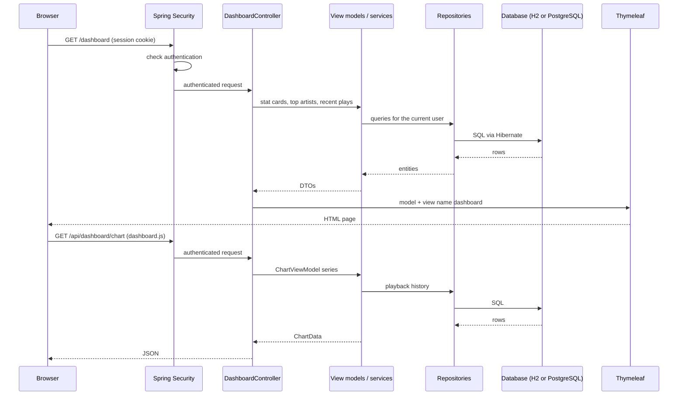

# MusicDashboard Web

The Spring Web edition of MusicDashboard: a personal music-library app (library browsing, playlists, import, listening analytics and playback) that runs in the browser. It is a second copy of the JavaFX desktop edition in which the JavaFX client layer was replaced by Spring MVC controllers, Thymeleaf templates and plain JavaScript and CSS.

## Table of contents

- [src](src/README.md): the Maven source tree (Java code in `src/main/java`, configuration, migrations, templates and static assets in `src/main/resources`)
- [Project overview](#project-overview)
- [Sequence diagram](#sequence-diagram)
- [Dependencies](#dependencies)
- [Tech stack](#tech-stack)
- [How to run](#how-to-run)
- [Relation to the desktop edition](#relation-to-the-desktop-edition)
- [References](#references)

## Project overview

MusicDashboard lets a user import audio files, browse them by song, album and artist, build playlists, play music and see listening statistics (stat cards, top songs, albums and artists, history, weekly, monthly and year-end reports, and a yearly line chart). This edition serves those features over HTTP.

Pages: `/login`, `/dashboard`, `/library`, `/playlist`, `/import`, `/analytics` and `/settings`. JSON endpoints live under `/api/**` and audio and cover art under `/media/**`. A small player bar sits at the bottom of every page except the dashboard, which has the large player.

The code follows an N-tier layout inside `com.sebastiandorata.musicdashboard`:

- `controller`: Spring MVC controllers and the Spring Security configuration. They map routes and shape responses, nothing more.
- `service`: business logic (library, playlists, favourites, import, playback tracking, analytics handlers).
- `presentation`: view models that prepare data for pages and charts.
- `dto`: read-only snapshots handed to the views.
- `repository` and `entity`: Spring Data JPA repositories and Hibernate entities.
- `utils`: shared helpers.

Pages are rendered on the server with Thymeleaf<sup>1</sup> and are complete without JavaScript; the page scripts then call the JSON endpoints to refresh panels. Page state (filters, sort, selected tab) lives in the URL. Sign-in uses Spring Security form login<sup>2</sup>, and many users can be signed in at once because per-user state always comes from the authenticated principal, never from singletons.

Playback works like this: the browser plays audio with an HTML5 audio element<sup>3</sup> fed by `GET /media/song/{id}`, which supports HTTP Range requests so seeking works<sup>4</sup>. `MusicPlayerService` keeps the queue, one instance per browser session. The browser reports 20 seconds of playback (`POST /api/player/tracked`) and song ends (`POST /api/player/ended`), and `PlaybackTrackingService` records history exactly as the desktop app did.

Importing: the import page either scans a folder on the server or accepts browser uploads, which are stored under `musicdashboard.upload-dir` (default `~/.musicdashboard/uploads`) before import. Tags are read with jaudiotagger<sup>5</sup>.

The schema is managed by Flyway migrations<sup>6</sup> in `src/main/resources/db/migration`, and Hibernate only validates it (`ddl-auto=validate`).

## Sequence diagram

The primary flow: a signed-in user opens the dashboard, then the page's script asks for chart data as JSON.



## Dependencies

From `pom.xml` (versions managed by the Spring Boot 4.0.3 parent unless a version is listed):

| Dependency | Version | Purpose |
|---|---|---|
| spring-boot-starter-webmvc | managed (Boot 4.0.3) | Spring MVC and the embedded servlet container<sup>7</sup> |
| spring-boot-starter-thymeleaf | managed | Server-side HTML templates |
| spring-boot-starter-security | managed (Spring Security 7.0.4) | Form login, authorization, BCrypt |
| spring-boot-starter-data-jpa | managed | Spring Data repositories and Hibernate |
| spring-boot-starter-jdbc | managed | JDBC and the connection pool |
| spring-boot-starter-flyway | managed | Flyway schema migrations |
| spring-boot-devtools | managed (runtime, optional) | Automatic restart during development |
| h2 | 2.3.232 (runtime) | Embedded database, default profile |
| postgresql | managed (runtime) | PostgreSQL driver for the `postgres` profile |
| lombok | managed (optional) | Boilerplate reduction |
| jaudiotagger (com.github.RouHim) | 2.0.16 | Reading audio tags (artist, album, title, duration) |
| jna | 5.19.1 | Native access library |
| spring-boot-starter-*-test (data-jpa, jdbc, webmvc, security, flyway) | managed (test) | Test support |

`pom.xml` also pins `spring-framework.version` 7.0.6 and `spring-security.version` 7.0.4, and resolves jaudiotagger through the JitPack repository.

## Tech stack

- Java 25, Maven
- Spring Boot 4.0.3, Spring MVC, Spring Security 7, Spring Data JPA with Hibernate
- Thymeleaf templates, plain JavaScript and CSS (no framework, no front-end build step)
- Flyway migrations
- H2 2.3.232 file database (default) or PostgreSQL

## How to run

From this folder:

```bash
JAVA_HOME=$(/usr/libexec/java_home -v 25) mvn spring-boot:run
```

Then open `http://localhost:8080` and create an account on the sign-in page. `server.port` and the other settings are in `src/main/resources/application.properties`.

Database selection is by profile (`DB_PROFILE`):

- `embedded` (default): the H2 file `~/.musicdashboard/data/musicdashboard` opened with `AUTO_SERVER=TRUE`<sup>8</sup>, so several processes can use it at once.
- `postgres`: set `DB_PROFILE=postgres` and the `DB_PASSWORD` environment variable; the datasource points at `localhost:5432/MusicDashDB`.

The `application*.properties` files are git-ignored, as in the desktop project, so a fresh clone must create them.

## Relation to the desktop edition

The JavaFX desktop edition lives one folder up. Entities, repositories, services, DTOs and Flyway migrations are carried over. What changed:

- Controllers are Spring MVC controllers returning Thymeleaf views and JSON instead of JavaFX scene controllers.
- Many users can be signed in at once; per-user state comes from Spring Security.
- Page state lives in the URL instead of in scene objects.
- Import scans a server folder or takes browser uploads.
- Playback happens in the browser; the server keeps only the queue and records history.

Both editions use the same H2 file by default, so they share one library, accounts and listening history, and can run at the same time.

## References

1. Thymeleaf documentation. https://www.thymeleaf.org/documentation.html
2. Spring Security reference. https://docs.spring.io/spring-security/reference/
3. MDN, HTMLAudioElement. https://developer.mozilla.org/en-US/docs/Web/API/HTMLAudioElement
4. MDN, HTTP range requests. https://developer.mozilla.org/en-US/docs/Web/HTTP/Guides/Range_requests
5. jaudiotagger. https://github.com/RouHim/jaudiotagger
6. Flyway documentation. https://documentation.red-gate.com/flyway
7. Spring MVC reference. https://docs.spring.io/spring-framework/reference/web/webmvc.html (Spring Boot reference: https://docs.spring.io/spring-boot/)
8. H2, automatic mixed mode. https://www.h2database.com/html/features.html#auto_mixed_mode
