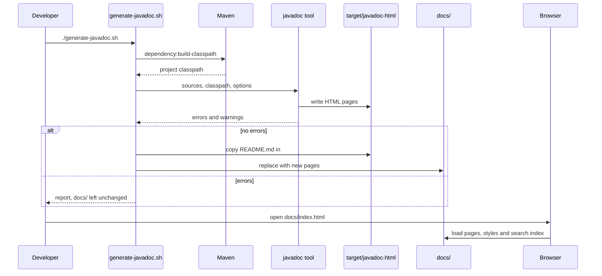

[← Back to root](../README.md)

# docs — generated Javadoc HTML

## Behavior

This folder holds the API documentation for the web edition's Java code, as HTML pages produced by the JDK's `javadoc` tool from the Javadoc comments in `src/main/java`. Open [index.html](index.html) in a browser to read it: it lists every package, and each class page shows the class description, its public and protected members, and their parameters and return values.

Everything here except this README is generated by [`generate-javadoc.sh`](../generate-javadoc.sh) in the project root. Do not edit the pages by hand: the next run replaces them.

## Responsibilities

- Owns the published, browsable form of the Javadoc comments, and nothing else.
- Does not own the documentation text itself. To change what a page says, edit the Javadoc comment in the Java source and run `./generate-javadoc.sh` again.
- Hand-written documentation (overviews, how-to-run notes, folder descriptions) belongs in the `README.md` files next to the code, not here.
- The generated subfolders (`com`, `index-files`, `legal`, `resource-files`, `script-files`) deliberately carry no `README.md` of their own: they are tool output and are deleted and rewritten on every run. This README is the one hand-written file, and the script preserves it.

## S.O.L.I.D. principles used

Not applicable: this folder contains generated HTML, CSS and JavaScript assets and no project logic.

## Code reused

None of the project's code is reused here. The pages are derived from the Javadoc comments under `src/main/java`, and the styling, search scripts and licence notices are the standard assets the `javadoc` tool writes with every run.

## Table of contents

Start here:

- [index.html](index.html): the overview page listing every package

Other generated pages and files:

- [allclasses-index.html](allclasses-index.html): every class, record, interface and enum on one page
- [allpackages-index.html](allpackages-index.html): every package on one page
- [overview-summary.html](overview-summary.html): redirect to the overview page
- [overview-tree.html](overview-tree.html): the class hierarchy for the whole project
- [constant-values.html](constant-values.html): the values of the public constants
- [serialized-form.html](serialized-form.html): the serialized form of the serializable classes
- [search.html](search.html): the search page
- [help-doc.html](help-doc.html): how the generated documentation is organised
- [element-list](element-list): the package list other Javadoc builds use to link to this one
- [member-search-index.js](member-search-index.js), [module-search-index.js](module-search-index.js), [package-search-index.js](package-search-index.js), [tag-search-index.js](tag-search-index.js), [type-search-index.js](type-search-index.js): the data behind the search box

Generated subfolders (no README of their own, see Responsibilities):

- `com/`: one page per package and per class, mirroring the Java package tree; begin at [the root package](com/sebastiandorata/musicdashboard/package-summary.html)
- `index-files/`: the alphabetical index, one page per letter, starting at [index-1.html](index-files/index-1.html)
- `resource-files/`: the stylesheet, icons and fonts, such as [stylesheet.css](resource-files/stylesheet.css)
- `script-files/`: the scripts for navigation and search, such as [script.js](script-files/script.js)
- `legal/`: licence notices for the bundled assets, such as [LICENSE](legal/LICENSE)

Back to the [root README](../README.md).

## Sequence diagram

How these pages are produced and read:

