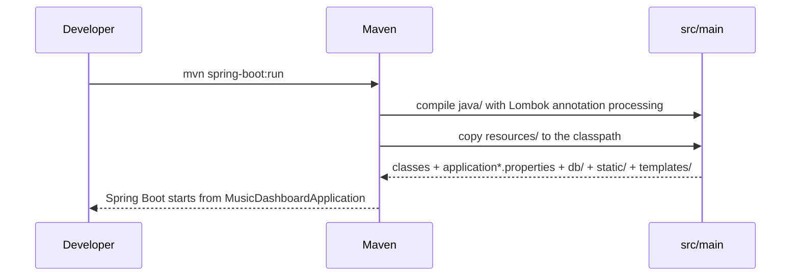

[← Back to root](../README.md)

# src

## Behavior

`src/` is the only top-level source folder of the Maven project. Maven's standard layout splits it into `main/` (the application: Java code and resources). There is no `test/` folder at the moment, so nothing under `src/` is compiled as test code.

## Responsibilities

- Owns the Maven source layout and nothing else; every file of the application lives below `main/`.
- Does not hold build output (that goes to `target/`, see `buildDir` in `pom.xml`), configuration for tools, or documentation outside READMEs.

## S.O.L.I.D. principles used

Not applicable: this folder holds no logic of its own, so none of the five principles can be shown here.

## Code reused

None.

## Table of contents

- [main/](main/README.md)
- [← Back to root](../README.md)

## Sequence diagram

