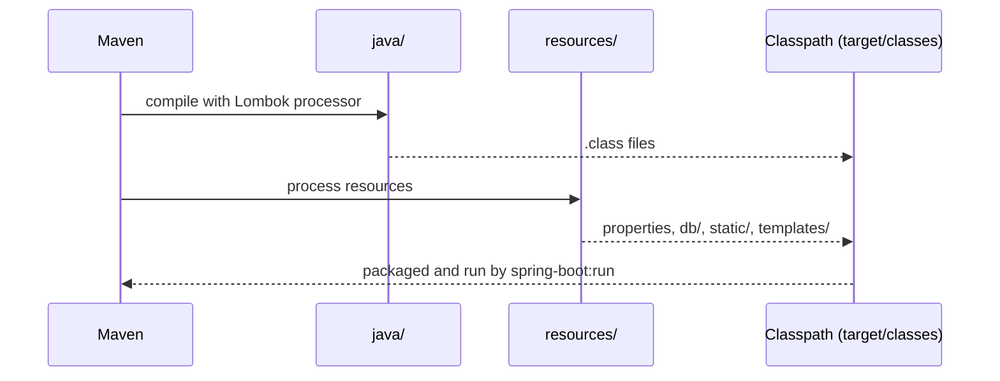

[← Back to root](../../README.md)

# src/main

## Behavior

`main/` is Maven's production source set. `java/` is compiled by `maven-compiler-plugin` (with the Lombok annotation processor configured in `pom.xml`); `resources/` is copied unchanged onto the classpath, where Spring Boot reads `application*.properties`, Flyway reads `db/migration`, Spring MVC serves `static/` and Thymeleaf resolves `templates/`.

## Responsibilities

- Splits the application into code (`java/`) and classpath resources (`resources/`).
- Does not contain build scripts, secrets or generated files; those belong to the project root or `target/`.

## S.O.L.I.D. principles used

Not applicable: this folder holds no logic of its own, so none of the five principles can be shown here.

## Code reused

None.

## Table of contents

- [java/](java/README.md)
- [resources/](resources/README.md)
- [← Back to root](../../README.md)

## Sequence diagram

