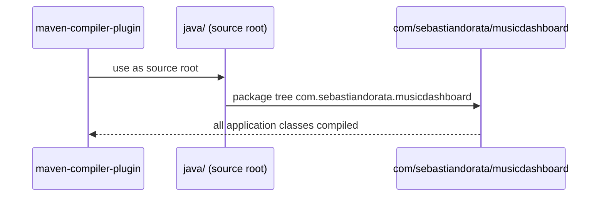

[← Back to root](../../../README.md)

# src/main/java

## Behavior

The Java source root. Everything is in the `com` package tree that leads to `com.sebastiandorata.musicdashboard`; the compiler turns it into classes that Spring Boot scans starting from the `@SpringBootApplication` class.

## Responsibilities

- Holds only package folders; no `.java` file sits directly here.
- Non-Java files (properties, SQL, HTML, JS, CSS) do not belong here; they go in `src/main/resources`.

## S.O.L.I.D. principles used

Not applicable: this folder holds no logic of its own, so none of the five principles can be shown here.

## Code reused

None.

## Table of contents

- [com/](com/README.md)
- [← Back to root](../../../README.md)

## Sequence diagram

