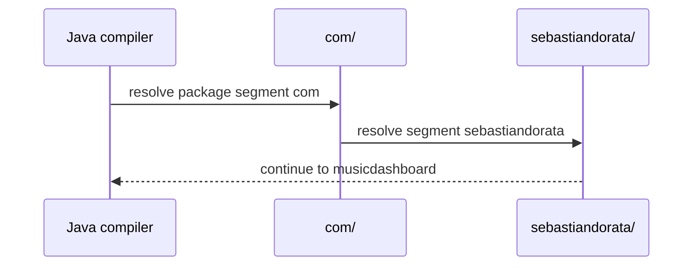

[← Back to root](../../../../README.md)

# com

## Behavior

Top of the reverse-domain package name. It only contains the `sebastiandorata` folder and exists because Java maps package segments to folders.

## Responsibilities

- Holds the single package segment `sebastiandorata`.
- Must not receive classes; new code goes into a layer package under `musicdashboard/`.

## S.O.L.I.D. principles used

Not applicable: this folder holds no logic of its own, so none of the five principles can be shown here.

## Code reused

None.

## Table of contents

- [sebastiandorata/](sebastiandorata/README.md)
- [← Back to root](../../../../README.md)

## Sequence diagram

