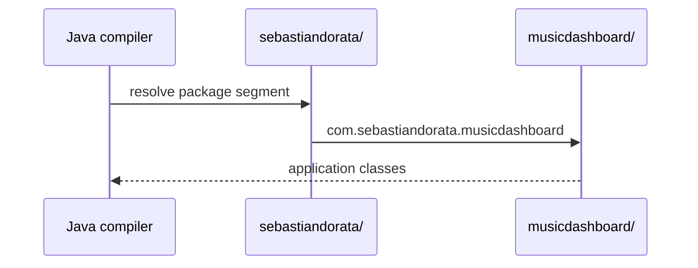

[← Back to root](../../../../../README.md)

# sebastiandorata

## Behavior

Owner segment of the package name. It contains only the `musicdashboard` application package.

## Responsibilities

- Holds the single package `musicdashboard`.
- Must not receive classes or a second application; it is purely a namespace.

## S.O.L.I.D. principles used

Not applicable: this folder holds no logic of its own, so none of the five principles can be shown here.

## Code reused

None.

## Table of contents

- [musicdashboard/](musicdashboard/README.md)
- [← Back to root](../../../../../README.md)

## Sequence diagram

