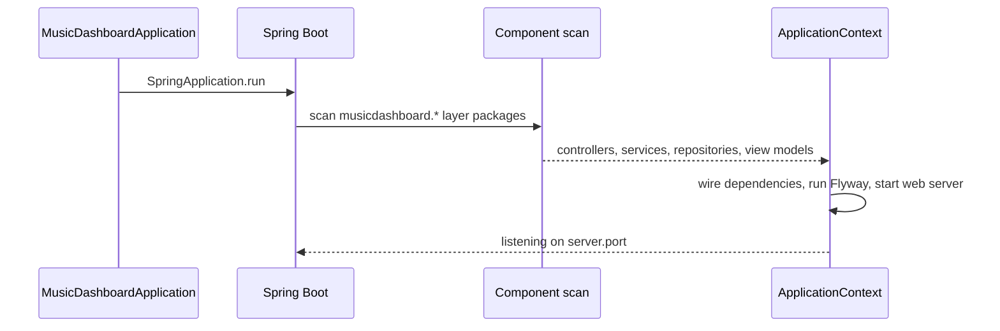

[← Back to root](../../../../../../README.md)

# musicdashboard (package root)

## Behavior

The package root of the web edition. `MusicDashboardApplication` is annotated with `@SpringBootApplication`, so Spring Boot component-scans this package and every layer package below it. Unlike the desktop edition, it starts no JavaFX toolkit: `SpringApplication.run` starts the embedded servlet container and the MVC controllers take the place of the JavaFX scenes. Layers: `controller` (HTTP and security), `service` (business logic), `repository` (Spring Data JPA), `entity` (JPA mappings), `dto` (read-only snapshots), `presentation` (view models that shape data for pages), `utils` (shared helpers).

## Responsibilities

- Owns the application entry point and the layered package structure.
- Business rules do not belong in the root class or in `controller`; they live in `service`. SQL and persistence live in `repository` and `entity`.

## S.O.L.I.D. principles used

- **Single Responsibility:** `MusicDashboardApplication` only bootstraps Spring; each layer package has one job.
- **Dependency Inversion:** because the root class triggers component scanning, layers receive collaborators from the Spring container instead of constructing them.

## Code reused

The entry point replaces the desktop edition's JavaFX launcher; entities, repositories, services and DTOs are carried over from the desktop project.

## Table of contents

- [MusicDashboardApplication.java](MusicDashboardApplication.java)
- [controller/](controller/README.md)
- [dto/](dto/README.md)
- [entity/](entity/README.md)
- [presentation/](presentation/README.md)
- [repository/](repository/README.md)
- [service/](service/README.md)
- [utils/](utils/README.md)
- [← Back to root](../../../../../../README.md)

## Sequence diagram

