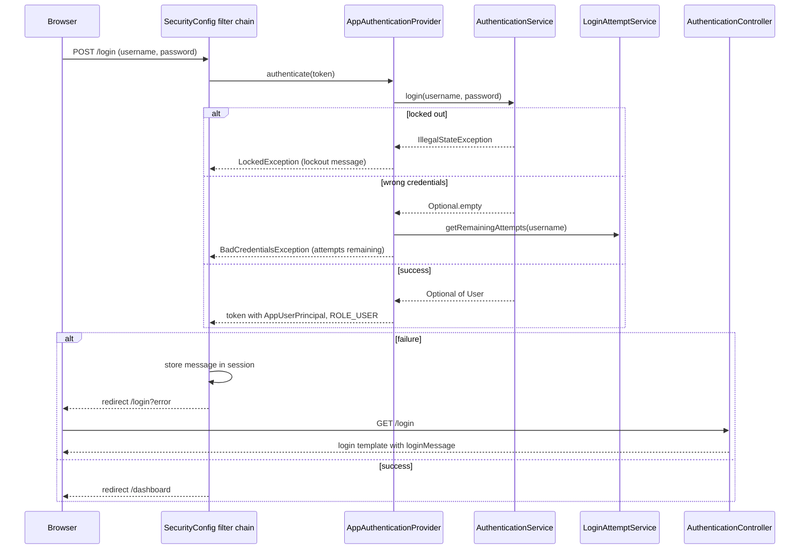

[← Back to root](../../../../../../../../README.md)

# controller/Authentication — login, registration and security

## Behavior
This folder connects Spring Security to the app's existing authentication services. `SecurityConfig` defines the filter chain: `/login`, `/register`, `/css/**`, `/js/**`, `/icons/**`, `/favicon.ico` and `/error` are public, every other URL needs a logged-in user, form login posts to `/login`, success always continues to `/dashboard`, logout is `POST /logout` and CSRF stays on. On failure a handler stores the exception message in the session (`LOGIN_ERROR_MESSAGE`) and redirects to `/login?error`.

`AppAuthenticationProvider` does the actual check by calling `AuthenticationService.login` (BCrypt verification plus `LoginAttemptService` lockouts and its failed-attempt delay). It only translates outcomes: empty fields or wrong credentials become `BadCredentialsException` (with the remaining-attempts text), a lockout (`IllegalStateException`) becomes `LockedException`, anything else `AuthenticationServiceException`. On success it builds an `AppUserPrincipal` (id, username, email, login time; no entity, no hash) with role `ROLE_USER`.

`AuthenticationController` renders the login/sign-up page, shows the one-time error or logout notice, redirects already-logged-in users to the dashboard, and implements `POST /register` by validating input and calling `AuthenticationService.register`.

## Responsibilities
- Owns the security filter chain, the `BCryptPasswordEncoder` bean, the principal type, the Spring Security adapter and the login/register web endpoints.
- Does **not** own credential rules, hashing logic or lockout counting: those stay in `service/AuthenticationService` and `service/LoginAttemptService`. Reading the current user in other code goes through `UserSessionService`.

## S.O.L.I.D. principles used
- **Single Responsibility**: `SecurityConfig` is wiring only; `AppAuthenticationProvider` only adapts the service to the Spring Security contract; `AppUserPrincipal` only carries identity.
- **Dependency Inversion**: `AppAuthenticationProvider` depends on `AuthenticationService` and `LoginAttemptService`, not on repositories; `SecurityConfig.securityFilterChain` receives the provider as a parameter.
- **Liskov Substitution**: `AppAuthenticationProvider` honours the `AuthenticationProvider` contract (`authenticate`, `supports`), and `AppUserPrincipal` is a valid `java.security.Principal`.

## Code reused
- `AuthenticationService` (`login`, `register`) and `LoginAttemptService` (`getRemainingAttempts`) from `service/`.
- The `User` entity (read once to build the principal).
- The `login.html` template under `src/main/resources/templates`.

## Table of contents
- [AppAuthenticationProvider.java](AppAuthenticationProvider.java) — delegates login to `AuthenticationService`, maps outcomes to Spring Security exceptions
- [AppUserPrincipal.java](AppUserPrincipal.java) — immutable record of the logged-in user kept in the security context
- [AuthenticationController.java](AuthenticationController.java) — `GET /login` page and `POST /register`
- [SecurityConfig.java](SecurityConfig.java) — filter chain, form login, logout and password encoder bean
- [← Back to root](../../../../../../../../README.md)

## Sequence diagram

