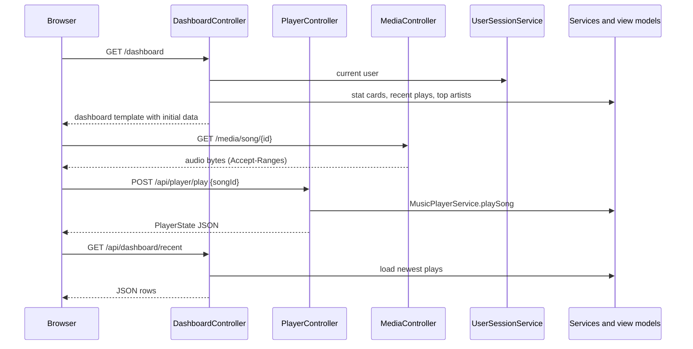

[← Back to root](../../../../../../../README.md)

# controller — Spring MVC pages and JSON APIs

## Behavior
This folder is the web layer that replaced the JavaFX client. Each page of the old desktop app became a `@Controller` that maps a URL, builds a model and returns a Thymeleaf template name; the screen state the desktop kept in fields (selected tab, report, playlist, month) now lives in the URL query string, so every request builds fresh state.

Pages: `/` redirects to `/dashboard`; `/dashboard`, `/analytics`, `/library`, `/playlist`, `/import` and `/settings` render templates. The same controllers also expose small JSON endpoints under `/api/**` that the plain JS files call (dashboard panels and chart, "view all" analytics modals, library edits and favourites, playlist CRUD, import start and progress). `PlayerController` is the JSON bridge between the browser audio element and the session-scoped `MusicPlayerService`, and `MediaController` streams audio (`GET /media/song/{id}`, with range support for seeking) and album art from paths stored in the database. `GlobalModelAdvice` adds `currentUsername` to every view.

Controllers never return entities to JSON: they map to small immutable records declared inside each controller.

## Responsibilities
- Owns URL mappings, request parsing and validation, mapping entities/DTOs to view records, and HTTP status codes (400/404).
- Does **not** own business rules, caching, persistence or playback logic: those go in `service/`. Login and security wiring go in `Authentication/`. HTML belongs in the templates, behaviour in the JS files.
- Ownership checks (for example a playlist or import job must belong to the current user) are done here by asking `UserSessionService` for the user.

## S.O.L.I.D. principles used
- **Single Responsibility**: `MainController` only redirects; `GlobalModelAdvice` only adds shared model attributes; `MediaController` only serves files.
- **Dependency Inversion**: `PlayerController` talks to the session-scoped `MusicPlayerService` through its injected proxy; `AnalyticsController` depends on view models and `AnalyticsCacheService` rather than repositories.
- **Open/Closed**: `AnalyticsController` renders sections from a `REPORT_KEYS` list with one `add...` method per report, so a new report is a new method and fragment.

## Code reused
- Services: `UserSessionService`, `LibraryService`, `FavouriteService`, `GenreFilterService`, `PlaylistService`, `PlaybackTrackingService`, `SongImportService`, `MusicPlayerService`, `ImportOrchestrator`, `ImportJobRegistry`, `AnalyticsCacheService`.
- Repositories: `SongRepository`, `AlbumRepository`, `ArtistRepository`, `GenreRepository`.
- The desktop view models (`StatCardsViewModel`, `TopArtistsViewModel`, `ChartViewModel`, `WeeklyReportViewModel` and others), `LibraryState`, DTOs such as `MonthlyReportData`, and utils `ArtistUtils`, `AppUtils`, `DoublyLinkedList`, `SortStrategy`.
- Thymeleaf templates and fragments under `src/main/resources/templates`.

## Table of contents
- [Authentication/](Authentication/README.md) — Spring Security login, registration and principal
- [AnalyticsController.java](AnalyticsController.java) — My Reports page and `/api/analytics/*` paged JSON
- [DashboardController.java](DashboardController.java) — dashboard page and `/api/dashboard/*` panel/chart JSON
- [GlobalModelAdvice.java](GlobalModelAdvice.java) — adds `currentUsername` to every model
- [ImportController.java](ImportController.java) — import page, scan/upload start and job status
- [MainController.java](MainController.java) — redirects `/` to the dashboard
- [MediaController.java](MediaController.java) — streams song audio and album art
- [MyLibraryController.java](MyLibraryController.java) — library page and `/api/library/*` edit/delete/favourite
- [PlayerController.java](PlayerController.java) — `/api/player/*` queue and playback state
- [PlaylistController.java](PlaylistController.java) — playlist page and `/api/playlists/*` CRUD
- [SettingsController.java](SettingsController.java) — empty Settings page on the shared layout
- [← Back to root](../../../../../../../README.md)

## Sequence diagram

