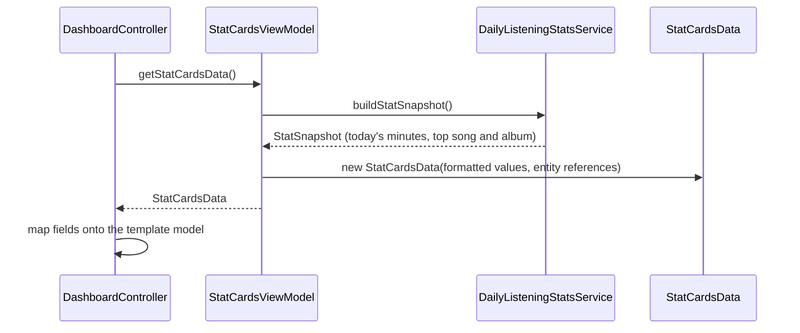

[← Back to root](../../../../../../../README.md)

# dto — data carriers handed to controllers and templates

## Behavior

This folder holds the plain data objects that move from the service and view-model layer to the web layer (controllers, Thymeleaf templates and the JSON read by the dashboard JavaScript). Nothing here queries the database or calls a service. The types fall into five groups:

- **Dashboard stat cards**: `StatCardsData` (formatted strings and entity references for the five cards) and `StatSnapshot` (values from one playback history fetch).
- **Dashboard chart**: `ChartData` (three monthly series) and `AllTimeStatsData` (all-time and year-over-year totals).
- **Analytics rows**: `HistoryRowData`, `TopSongRowData`, `TopAlbumRowData` and `TopArtistRowData`, one row each for the history, songs, albums and artists views.
- **Report cards**: `WeeklyReportData` and `MonthlyReportData`, pre-formatted for display.
- **Import**: `ExtractedSongMetadata` (everything read from one audio file in a single pass) and `MigrationResult` (the outcome for one file, with its nested `Status` enum).

The four records (`ExtractedSongMetadata`, `MigrationResult`, `StatCardsData`, `StatSnapshot`) are immutable. The other classes are ordinary classes with public, non-final fields that a view model fills in once. The Last.fm records live in the `lastfm/` subfolder.

## Responsibilities

Owns the shape of each value handed across the web boundary, including the formatting already applied to it (formatted numbers, "—" placeholders, relative times).

Does not own:
- Database access and aggregation: `repository/` and `service/handlers/` (for example `PlaybackAggregator` in `utils/`).
- Building the values: the view models in `presentation/` (for example `StatCardsViewModel` fills `StatCardsData`).
- Formatting helpers: `utils/AppUtils`.
- JPA entities: `entity/`. Row DTOs keep an entity reference only so that click handlers can navigate or start playback.
- Last.fm HTTP calls and JSON parsing.

## S.O.L.I.D. principles used

- **Single Responsibility**: each class carries exactly one display or result shape, for example `HistoryRowData` for one history row and `ChartData` for the chart series.
- **Open/Closed**: not applicable, there is no behavior to extend; a new shape is a new class.
- **Liskov Substitution**: not applicable, no inheritance.
- **Interface Segregation**: not applicable, no interfaces.
- **Dependency Inversion**: not applicable, no collaborators; the types depend only on JDK types (`YearMonth`, `LocalDate`) and entity classes.

## Code reused

Reuses the entity classes from `entity/` (`Song`, `Album`, `Artist`) as field types in the row and card DTOs, and `java.time.YearMonth` as map keys in `ChartData`. No helper is called from this folder. Formatting is done by the callers, for example `AppUtils.formatRelativeTime` produces the `playedAt` text of `HistoryRowData`.

## Table of contents

- [AllTimeStatsData.java](AllTimeStatsData.java) — all-time and year-over-year listening totals for the graph info panel
- [ChartData.java](ChartData.java) — three monthly listening series (current, previous and all-time high year) for the line chart
- [ExtractedSongMetadata.java](ExtractedSongMetadata.java) — everything read from one audio file in a single pass
- [HistoryRowData.java](HistoryRowData.java) — one row of the listening history view
- [MigrationResult.java](MigrationResult.java) — outcome of one file during import, with its `Status` enum
- [MonthlyReportData.java](MonthlyReportData.java) — pre-formatted monthly report card
- [StatCardsData.java](StatCardsData.java) — the five dashboard stat cards as display strings plus entity references
- [StatSnapshot.java](StatSnapshot.java) — stat-card values derived from one playback history fetch
- [TopAlbumRowData.java](TopAlbumRowData.java) — one row of the top albums view
- [TopArtistRowData.java](TopArtistRowData.java) — one row of the top artists panel and modal
- [TopSongRowData.java](TopSongRowData.java) — one row of the top songs view
- [WeeklyReportData.java](WeeklyReportData.java) — pre-formatted weekly report card
- [lastfm/README.md](lastfm/README.md) — subfolder with the Last.fm scrobble records
- [← Back to root](../../../../../../../README.md)

## Sequence diagram

