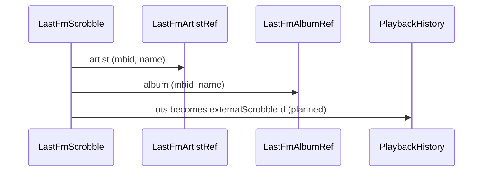

[← Back to root](../../../../../../../../README.md)

# lastfm — Last.fm scrobble records

## Behavior

Three immutable records that mirror the parts of Last.fm's `user.getRecentTracks` response the app uses. `LastFmScrobble` is one play, flattened from the nested `recenttracks[].track[]` JSON: resolved artist and album references, the track title, an optional MusicBrainz recording id, and `uts`, the Unix timestamp the play was recorded at. `LastFmArtistRef` and `LastFmAlbumRef` hold the `mbid` and display name of the artist or album.

The records are plain carriers. Nothing here calls Last.fm, parses JSON or validates values, and blank `mbid` values are passed through unchanged, so callers must treat them as possibly missing.

Per the Javadoc, `uts` is the source of `PlaybackHistory.externalScrobbleId`, which is meant to let a re-import skip scrobbles that were already stored. No code outside this folder references these three records yet, so that import step is not in this codebase.

## Responsibilities

Owns the in-memory shape of one Last.fm scrobble and of the artist and album references inside it.

Does not own:
- HTTP calls to the Last.fm API and JSON parsing: the service layer (`service/`).
- Matching a scrobble to a library song or de-duplicating it: the import services in `service/`, using `PlaybackHistory` in `entity/`.
- Persisting plays: `entity/PlaybackHistory` and `repository/`.

## S.O.L.I.D. principles used

- **Single Responsibility**: each record mirrors one thing from Last.fm, an artist reference (`LastFmArtistRef`), an album reference (`LastFmAlbumRef`) or one play (`LastFmScrobble`).
- **Open/Closed**, **Liskov Substitution**, **Interface Segregation**, **Dependency Inversion**: not applicable. The records have no behavior, no inheritance, no interfaces and no collaborators.

## Code reused

None. The records are plain Java. The only link to other code is the Javadoc reference to `PlaybackHistory.externalScrobbleId`.

## Table of contents

- [LastFmAlbumRef.java](LastFmAlbumRef.java) — album reference (MusicBrainz id and title) inside a scrobble
- [LastFmArtistRef.java](LastFmArtistRef.java) — artist reference (MusicBrainz id and name) inside a scrobble
- [LastFmScrobble.java](LastFmScrobble.java) — one flattened Last.fm play with its artist, album, track and timestamp
- [← Back to root](../../../../../../../../README.md)
- [↑ Parent: dto](../README.md)

## Sequence diagram

How one scrobble's values are carried into the play record. The import step that builds these records is not in the project yet, so the flow shows the mapping only.

