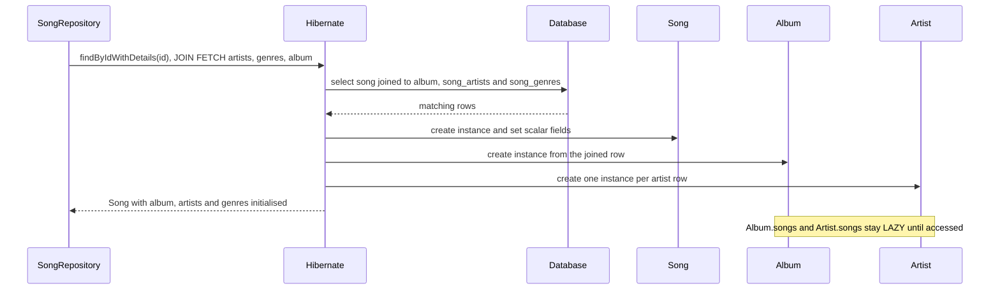

[← Back to root](../../../../../../../README.md)

# entity — JPA entities mapped to the database tables

## Behavior

Twelve `@Entity` classes, one per table, annotated with `jakarta.persistence`. Each class maps its fields to columns and declares its relationships. Hibernate loads and saves them through the interfaces in `repository/`. Tables: `users`, `albums`, `artists`, `songs`, `genres`, `playlists`, `playback_history`, `favourites`, `sync_queue`, `monthly_reports`, `weekly_reports` and `year_end_reports`.

Key mappings:
- `Song` is the central entity. `filePath` is unique, `contentFingerprint` is indexed, `album` is many-to-one, and `artists` and `genres` are many-to-many through `song_artists` and `song_genres`. `isPlaceholder` marks songs that exist only as metadata. The Javadoc notes that adding the unique `file_path` constraint to an existing database needs `sql/01_dedupe_songs_and_albums.sql` run first.
- `Album` and `Artist` are many-to-many through `album_artists`. `Album.songs` and `Artist.songs` are lazy inverse sides.
- `Playlist` and `Song` are many-to-many through `playlist_songs`.
- `PlaybackHistory` links a `User` and a `Song` with `playedAt`, `durationPlayedSeconds` and a unique `externalScrobbleId`. Composite indexes cover (user, playedAt) and (song, playedAt).
- `MonthlyReport`, `WeeklyReport` and `YearEndReport` store pre-computed summaries with many-to-one links to a top song, top artist, top album song and top genre. Each has a unique constraint on its user and period.
- `User` holds a unique email and username and a BCrypt password hash. Hashing is delegated to `SecurityConfig`, per the Javadoc.
- `SyncQueueEntry` stores a pending offline action with a JSON payload and a status string.

## Responsibilities

Owns table and column mapping, constraints, indexes, relationship mappings and fetch types.

Does not own:
- Queries and fetch joins: `repository/`.
- Aggregation and report generation: `utils/PlaybackAggregator` and `service/handlers/`.
- View rows and display strings: `dto/` and `presentation/`.
- Password hashing: `SecurityConfig`.

## S.O.L.I.D. principles used

- **Single Responsibility**: each entity maps exactly one table and holds only that table's state.
- **Open/Closed**, **Liskov Substitution**, **Interface Segregation**, **Dependency Inversion**: not applicable. The entities implement no interfaces, use no inheritance and have no injected collaborators; their only methods are constructors, getters, setters and `toString`.

## Code reused

None from elsewhere in the project. The entities depend only on Jakarta Persistence annotations and `java.time` types, plus references to each other inside this folder.

## Table of contents

- [Album.java](Album.java) — album with title, release year, MusicBrainz id and art path
- [Artist.java](Artist.java) — artist with unique name, MusicBrainz id and bio
- [Favourite.java](Favourite.java) — a user's favourited song and when it was favourited
- [Genre.java](Genre.java) — genre with a unique name
- [MonthlyReport.java](MonthlyReport.java) — stored monthly listening summary for one user
- [PlaybackHistory.java](PlaybackHistory.java) — one playback event with its user, song, time and duration
- [Playlist.java](Playlist.java) — user-created playlist and its songs
- [Song.java](Song.java) — track with file path, audio metadata, fingerprint and listen statistics
- [SyncQueueEntry.java](SyncQueueEntry.java) — pending offline action for future multi-device sync
- [User.java](User.java) — application user with credentials and login timestamps
- [WeeklyReport.java](WeeklyReport.java) — stored weekly listening summary for one user
- [YearEndReport.java](YearEndReport.java) — stored annual summary used by the Wrapped view
- [← Back to root](../../../../../../../README.md)

## Sequence diagram

Hibernate loading a `Song` with its album, artists and genres, as requested by `SongRepository.findByIdWithDetails`.

