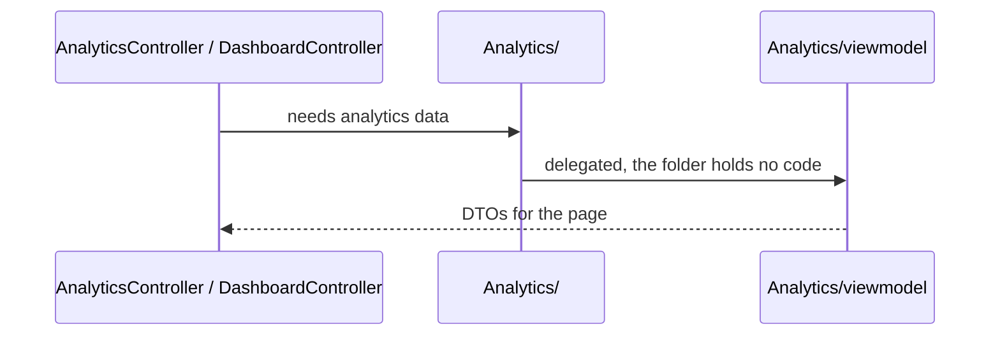

[← Back to root](../../../../../../../../README.md)

# Analytics

## Behavior

A grouping folder for the analytics view models. Its single subfolder, `viewmodel/`, contains the classes that prepare stat cards, top songs/albums/artists, listening history and weekly, monthly and year-end reports for the dashboard and analytics pages.

## Responsibilities

- Owns only the `viewmodel` subfolder.
- Does not contain classes directly; new analytics view models go into `viewmodel/`.

## S.O.L.I.D. principles used

Not applicable: this folder holds no logic of its own, so none of the five principles can be shown here.

## Code reused

None; reuse happens in `viewmodel/`.

## Table of contents

- [viewmodel/](viewmodel/README.md)
- [← Back to root](../../../../../../../../README.md)

## Sequence diagram

