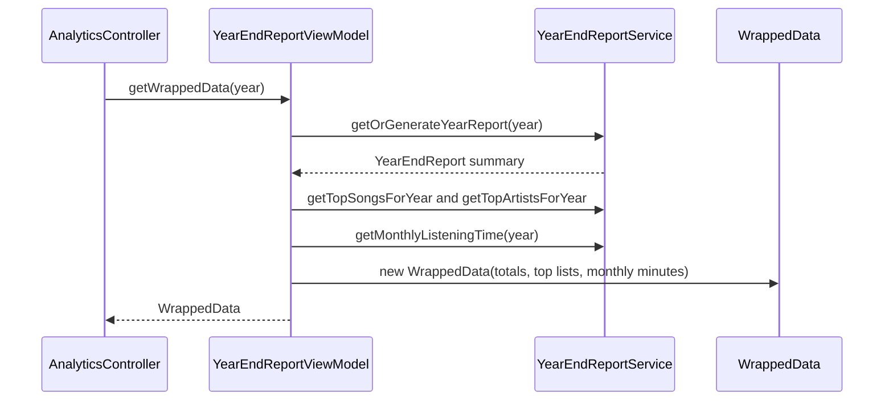

[← Back to root](../../../../../../../../../README.md)

# viewmodel — display view models for the reports, history, stat cards and top lists

## Behavior

Eight `@Service` classes that turn service results into display DTOs for the Analytics page and the dashboard panels. Each method runs synchronously on the request thread and returns its value directly.

- `ListeningHistoryViewModel`: a window of history rows and the row count, built from `ListeningHistoryService`, as `HistoryRowData`.
- `MonthlyReportViewModel` and `WeeklyReportViewModel`: one report as `MonthlyReportData` or `WeeklyReportData`, plus the months or weeks that have data.
- `YearEndReportViewModel`: `getWrappedData(year)` returns one nested `WrappedData` with totals, the top five songs and artists, and monthly minutes.
- `StatCardsViewModel`: `getStatCardsData()` makes one `buildStatSnapshot()` call and formats the result as `StatCardsData`.
- `TopSongsViewModel` and `TopAlbumsViewModel`: paginated windows and counts through `ListeningPaginationService`, as `TopSongRowData` and `TopAlbumRowData`.
- `TopArtistsViewModel`: `getTopArtistsData(limit)` for the dashboard panel, padded with "—" placeholders, and `buildAllArtistsRankedData()` for the analytics modal. It makes one history fetch and sums in a `HashMap`. It is the exception in this folder: it injects `PlaybackHistoryRepository` and `ArtistRepository` directly.

## Responsibilities

Owns turning service results into display DTOs for the Analytics pages and the dashboard panels.

Does not own:
- Queries and aggregation: `repository/`, `service/handlers/`.
- Shared math and rules over history: `utils/PlaybackAggregator` and `utils/PlaybackConstants`.
- The dashboard line chart series: `presentation/graph/ChartViewModel`.
- Library page state: `presentation/libraryViews/LibraryState`.
- Model attributes, HTTP and templates: `controller/` and the templates.

## S.O.L.I.D. principles used

- **Single Responsibility**: each view model serves one page section, and each class comment says it only shapes data for display; `ListeningHistoryViewModel` is the example, with querying left to `ListeningHistoryService`.
- **Open/Closed**, **Liskov Substitution**, **Interface Segregation**: not applicable, there are no interfaces or inheritance hierarchies.
- **Dependency Inversion**: not applied. The view models inject concrete service classes with `@Autowired`, not interfaces.

## Code reused

- Services in `service/handlers/`: `ListeningHistoryService`, `ListeningPaginationService`, `DailyListeningStatsService`, `MonthlyReportService`, `WeeklyReportService`, `YearEndReportService` and `ArtistListeningTimeService`.
- `DoublyLinkedList` from `utils/`, returned by the pagination services and by `TopArtistsViewModel.buildAllArtistsRankedData()`.
- `ArtistUtils` (in `ListeningHistoryViewModel`, `TopSongsViewModel` and `YearEndReportViewModel`) and `AppUtils.formatRelativeTime` (in `ListeningHistoryViewModel`).
- DTOs from `dto/`, and `ChartData` and `AllTimeStatsData` are used by the graph package, not here.

## Table of contents

- [ListeningHistoryViewModel.java](ListeningHistoryViewModel.java) — history rows and count for the Analytics history view
- [MonthlyReportViewModel.java](MonthlyReportViewModel.java) — monthly report card data and the months with data
- [StatCardsViewModel.java](StatCardsViewModel.java) — the five dashboard stat cards from one stats snapshot
- [TopAlbumsViewModel.java](TopAlbumsViewModel.java) — paginated top album rows and count
- [TopArtistsViewModel.java](TopArtistsViewModel.java) — top artist rows for the dashboard panel and the full analytics ranking
- [TopSongsViewModel.java](TopSongsViewModel.java) — paginated top song rows and count
- [WeeklyReportViewModel.java](WeeklyReportViewModel.java) — weekly report card data and the weeks with data
- [YearEndReportViewModel.java](YearEndReportViewModel.java) — the Wrapped data for one year, including its nested `WrappedData`
- [← Back to root](../../../../../../../../../README.md)

## Sequence diagram

`AnalyticsController` requests the year-end Wrapped data. The view model gets the stored summary and the rankings from the service, and returns a display object.

