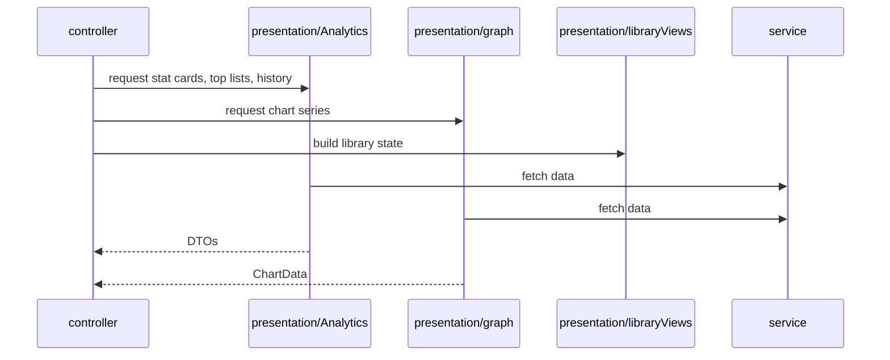

[← Back to root](../../../../../../../README.md)

# presentation

## Behavior

Groups the view models that turn services' data into what a page needs: `Analytics/` (stat cards, top lists, listening history and reports), `graph/` (the dashboard line-chart series) and `libraryViews/` (library page state). The folder itself contains only these subfolders.

## Responsibilities

- Owns view-model packages that sit between controllers and services.
- Does not hold controllers, HTML or persistence code, and no class belongs directly in this folder.

## S.O.L.I.D. principles used

Not applicable: this folder holds no logic of its own, so none of the five principles can be shown here.

## Code reused

None; reuse happens in the subfolders.

## Table of contents

- [Analytics/](Analytics/README.md)
- [graph/](graph/README.md)
- [libraryViews/](libraryViews/README.md)
- [← Back to root](../../../../../../../README.md)

## Sequence diagram

