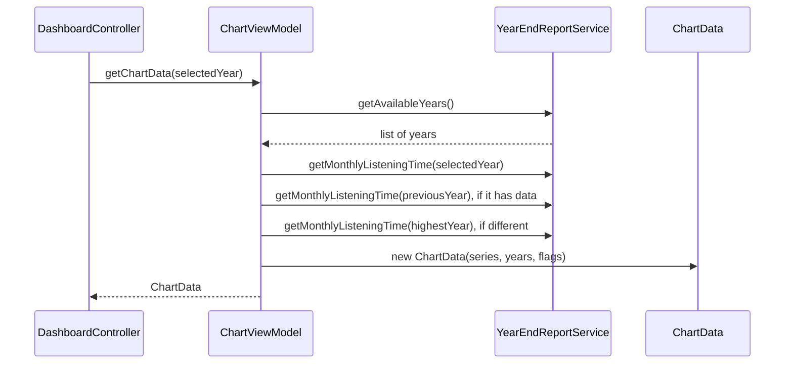

[← Back to root](../../../../../../../../README.md)

# graph — data for the dashboard listening chart

## Behavior

One `@Service`, `ChartViewModel`, which supplies the data behind the dashboard line chart and its info panel.

- `getChartData(selectedYear)` reads the available years from `YearEndReportService.getAvailableYears()`, finds the highest-listening year, and reads the monthly listening maps for the selected year and, when they exist, the previous year and the highest year. It returns a `ChartData`. The previous-year flags are computed from the year list, and the previous-year map is filled only when that year appears in the history.
- `getAllTimeStatsForGraph(selectedYear)` walks every available year through `getOrGenerateYearReport`, sums hours, and compares the selected year with the previous year and the all-time high. It returns an `AllTimeStatsData`.
- `getAllAvailableYears()` is a public wrapper for the year list. Its Javadoc marks it as reserved for future use.

## Responsibilities

Owns the chart's series selection (current, previous and highest year) and the all-time comparison numbers.

Does not own:
- Year-end report generation and the underlying queries: `service/handlers/YearEndReportService` and `repository/`.
- Converting results to JSON for the page: `controller/DashboardController` (its `toAllTime` and `AllTimeStatsJson` helpers).
- Drawing the chart: the static JavaScript in `static/`.
- Stat cards and top lists: `presentation/Analytics/viewmodel/`.

## S.O.L.I.D. principles used

- **Single Responsibility**: this class only builds the chart series and the graph's all-time figures; the drawing and the JSON shaping live elsewhere.
- **Open/Closed**, **Liskov Substitution**, **Interface Segregation**, **Dependency Inversion**: not applied. There is one concrete class, and it injects the concrete `YearEndReportService` with `@Autowired`.

## Code reused

- `YearEndReportService` from `service/handlers/` for available years, monthly listening maps and year reports.
- `ChartData` and `AllTimeStatsData` from `dto/` as the return types.

## Table of contents

- [ChartViewModel.java](ChartViewModel.java) — builds the chart's monthly series and the all-time graph statistics
- [← Back to root](../../../../../../../../README.md)

## Sequence diagram

`DashboardController` asks for the chart data for one year. The view model reads the available years and up to three monthly series from `YearEndReportService`, then returns a `ChartData`.

