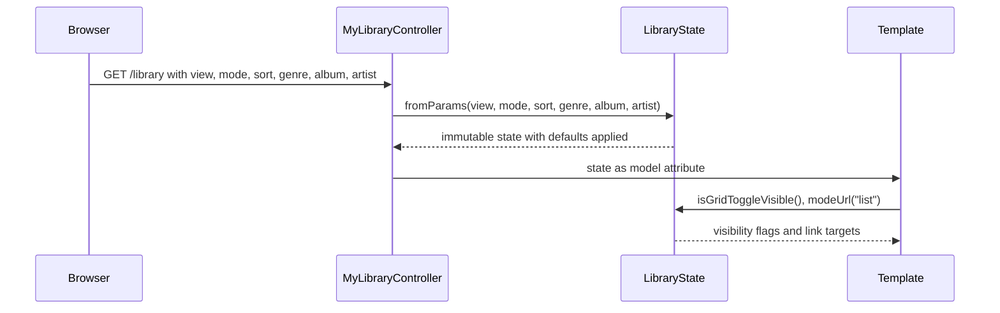

[← Back to root](../../../../../../../../README.md)

# libraryViews — per-request view state of the My Library page

## Behavior

`LibraryState` is a final, immutable object built once for each `GET /library` request by `LibraryState.fromParams(view, mode, sort, genre, album, artist)`. The state lives in the URL, not in the server, so nothing is kept between requests.

- Recognised parameters: `view` (`songs`, `albums`, `artists` or `favourites`), `mode` (`grid` or `list`), `sort` (a `SortStrategy` constant name), `genre` (a genre id), and the drill-ins `album` and `artist` (ids). An album drill-in wins over an artist drill-in.
- Missing or invalid values fall back to the desktop defaults: Albums view, grid mode, alphabetical sort and no genre filter. The artist drill-in forces the Artists tab, and the album drill-in forces list mode.
- Visibility helpers decide which controls appear: `isListToggleVisible`, `isGridToggleVisible`, `isFilterVisible`, `isAlbumDetail` and `isArtistDetail`.
- URL builders reproduce how the desktop changed state: `tabUrl` resets sort, genre and mode; `modeUrl` keeps view, sort and genre; `albumUrl` and `artistUrl` open a drill-in and keep the current tab where it makes sense.

## Responsibilities

Owns parsing and defaulting of the query parameters, the decision of which controls are shown, and the links a click produces.

Does not own:
- Loading songs, albums or artists: `controller/MyLibraryController` and `service/`.
- The sort orders themselves: `utils/SortStrategy`. `LibraryState` only stores the chosen constant.
- Page markup: the Thymeleaf templates.
- Any stored session or server-side state: the URL is the state.

## S.O.L.I.D. principles used

- **Single Responsibility**: the class only resolves and describes view state. It never touches a repository or a service, as its Javadoc states.
- **Open/Closed**, **Liskov Substitution**, **Interface Segregation**, **Dependency Inversion**: not applicable. It is a final class with no interfaces, no inheritance and no collaborators.

## Code reused

- `SortStrategy` from `utils/`, parsed from the `sort` parameter and used by `MyLibraryController` to fill the sort list.
- The desktop edition's defaults are reproduced by hand; no code is shared with the desktop project.

## Table of contents

- [LibraryState.java](LibraryState.java) — immutable view state built from query parameters, with visibility rules and URL builders
- [← Back to root](../../../../../../../../README.md)

## Sequence diagram

A library request: `MyLibraryController` builds the state from the URL, and the template uses it for visibility and links.

