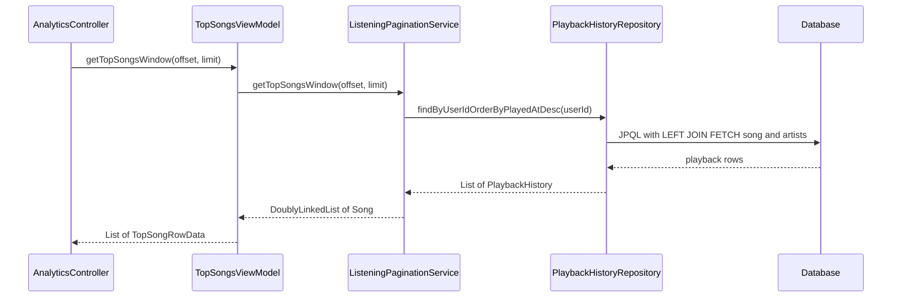

[← Back to root](../../../../../../../README.md)

# repository — Spring Data JPA repository interfaces

## Behavior

Twelve interfaces, one per entity that is queried. Each extends `JpaRepository<Entity, Long>`. Spring Data generates the implementations at startup, so this folder contains declarations only. The methods fall into three kinds:

- **Derived finders** named after entity properties, for example `SongRepository.findFirstByFilePath`, `UserRepository.existsByEmail` and `YearEndReportRepository.findByUserIdAndYear`.
- **JPQL `@Query` methods** that use `JOIN FETCH` to load a whole object graph in one round trip, for example `AlbumRepository.findAllWithArtists`, `SongRepository.findByIdWithDetails` and `PlaybackHistoryRepository.findByIdsWithSongs`.
- **`@Modifying` deletes** for cleanup: `FavouriteRepository.deleteBySongId`, `PlaybackHistoryRepository.deleteBySongId`, and the native `SongRepository.removeFromAllPlaylists`, which deletes from `playlist_songs`.

Two details matter to callers. `SongRepository` uses `findFirstBy...` for `filePath` and `contentFingerprint` on purpose: a plain `findBy` would throw `NonUniqueResultException` if duplicate rows exist. `PlaybackHistoryRepository` fetches recent history in two steps: first the ids of one page (`findRecentIdsByUserId` with a `Pageable`), then the full rows for those ids (`findByIdsWithSongs`). `UserRepository` is the only interface without a `@Repository` annotation; Spring Data registers it anyway.

## Responsibilities

Owns the query surface for each entity: which finders exist, which fetch joins they use and which bulk deletes exist.

Does not own:
- Business rules and aggregation such as top artist or listening totals: `utils/PlaybackAggregator` and `service/handlers/`.
- Transactions and orchestration: `service/`.
- Entity mapping: `entity/`.
- Shaping results into display rows: `presentation/` and `dto/`.

## S.O.L.I.D. principles used

- **Single Responsibility**: each repository serves one entity.
- **Open/Closed**: a new query is a new method declaration; Spring Data generates the body, and existing callers are unchanged.
- **Interface Segregation**: each interface exposes only its entity's operations; there is no shared catch-all DAO.
- **Dependency Inversion**: services depend on these interfaces (for example `SongRepository`), and Spring injects the generated implementation.
- **Liskov Substitution**: not applicable, there are no hand-written implementations to substitute.

## Code reused

Reuses the `JpaRepository` base interface and the `@Query`, `@Modifying`, `@Param` and `Pageable` types from Spring Data. The entity types come from `entity/`. No project utility code is used.

## Table of contents

- [AlbumRepository.java](AlbumRepository.java) — album lookup by title and album queries with artists and songs fetched
- [ArtistRepository.java](ArtistRepository.java) — artist lookup by name and artist queries with songs and albums fetched
- [FavouriteRepository.java](FavouriteRepository.java) — favourite lookups per user and song, plus a bulk delete by song
- [GenreRepository.java](GenreRepository.java) — genre lookup by name
- [MonthlyReportRepository.java](MonthlyReportRepository.java) — monthly report lookups by user, year and month
- [PlaybackHistoryRepository.java](PlaybackHistoryRepository.java) — playback history queries for analytics, reports and charts
- [PlaylistRepository.java](PlaylistRepository.java) — playlists belonging to a user
- [SongRepository.java](SongRepository.java) — song lookups by path or fingerprint, fetch-join queries and playlist cleanup
- [SyncQueueRepository.java](SyncQueueRepository.java) — pending sync entries by user and status
- [UserRepository.java](UserRepository.java) — user lookups and existence checks by email and username
- [WeeklyReportRepository.java](WeeklyReportRepository.java) — weekly report lookup by user, year and ISO week
- [YearEndReportRepository.java](YearEndReportRepository.java) — year-end report lookups by user and year
- [← Back to root](../../../../../../../README.md)

## Sequence diagram

A controller-to-database call through the analytics path: `AnalyticsController` asks `TopSongsViewModel` for a window of songs, which reaches `PlaybackHistoryRepository` through `ListeningPaginationService`.

