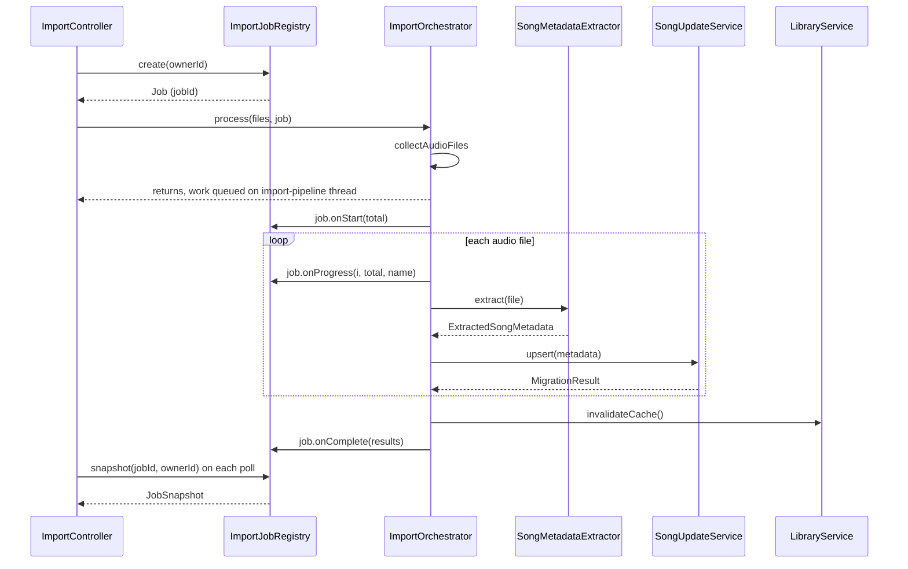

[← Back to root](../../../../../../../../README.md)

# service/Import — single-pass music import pipeline

## Behavior
Importing a library runs on a background thread so the HTTP request returns at once. `ImportController` creates a job in `ImportJobRegistry` and hands the folder or uploaded files plus that job to `ImportOrchestrator.process`. The orchestrator collects every `.mp3` and `.m4a` file (recursing into folders); if there are none it calls `onNoFiles`. Otherwise it queues the work on a single-threaded `import-pipeline` executor, so two imports never interleave.

For each file the pipeline does one read and one write: `SongMetadataExtractor.extract` reads the tags and header once and computes a content fingerprint (title, primary artist, duration); `SongUpdateService.upsert` then, in one transaction, matches by exact path, then by fingerprint (a moved file just gets its path updated), otherwise creates a new song. Each file yields a `MigrationResult`; read errors are recorded per file instead of aborting. At the end `LibraryService.invalidateCache()` runs once.

Progress reaches the browser through callbacks: `ImportJobRegistry.Job` implements `ImportCallbacks`, so the pipeline thread updates volatile fields (state, current, total, file name, results) while request threads read `snapshot(jobId, ownerId)`, which only returns a job to its owner. Finished jobs expire after 30 minutes. `SongImportService` is now just the read-side `getAllSongs()`.

## Responsibilities
- Owns file discovery, metadata extraction, matching/persistence of imported songs and job progress state.
- Does **not** own HTTP parsing, path sanitising or uploads (that is `controller/ImportController`), or library display and caching (`service/LibraryService`).

## S.O.L.I.D. principles used
- **Single Responsibility**: `SongMetadataExtractor` only reads files, `SongUpdateService` only persists, `ImportJobRegistry` only tracks job state.
- **Open/Closed**: a new matching rule or synced field changes only `SongUpdateService`; `ImportOrchestrator.runPipelineUnchecked` stays the same.
- **Dependency Inversion**: the orchestrator reports through the `ImportCallbacks` interface, so it never depends on the registry or the web layer.
- **Interface Segregation**: `ImportCallbacks` is small, with `onFailed` as a default method.

## Code reused
- `ExtractedSongMetadata` and `MigrationResult` DTOs; `Song`, `Album`, `Artist`, `Genre` entities and their repositories.
- `LibraryService` (cache invalidation) and `UserSessionService` (job owner, via the controller) from `service/`.

## Table of contents
- [ImportJobRegistry.java](ImportJobRegistry.java) — in-memory job map, `Job` callbacks, owner-checked snapshots
- [ImportOrchestrator.java](ImportOrchestrator.java) — collects audio files and runs the single-threaded pipeline
- [SongImportService.java](SongImportService.java) — read-only `getAllSongs()`
- [SongMetadataExtractor.java](SongMetadataExtractor.java) — one-pass tag read and content fingerprint
- [SongUpdateService.java](SongUpdateService.java) — path/fingerprint matching and upsert in one transaction
- [← Back to root](../../../../../../../../README.md)

## Sequence diagram

