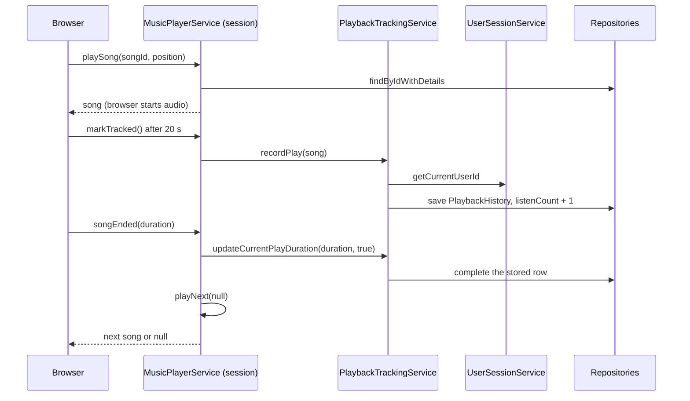

[← Back to root](../../../../../../../README.md)

# service — business logic for the web app

## Behavior
This folder holds the Spring `@Service` classes that implement the app's rules. They are shared by the Spring MVC controllers and were carried over from the JavaFX edition, adapted for a multi-user server: nothing user-specific is kept in a singleton field.

- **Identity and login**: `UserSessionService` reads the current user (id, username, session start) from the Spring Security context. `AuthenticationService` registers users and checks logins with BCrypt, always running a hash check to prevent username enumeration; `LoginAttemptService` keeps in-memory failed-attempt counts, applies a 5-second delay per failure and escalating lockouts (5 min, 10 min, 30 min, then permanent).
- **Library**: `LibraryService` is a cached facade over song, album and artist retrieval and the delete operations; `GenreFilterService` filters songs/albums by genre; `FavouriteService` and `PlaylistService` manage the current user's favourites and playlists.
- **Playback**: `MusicPlayerService` is session scoped (one per browser session) and holds the shuffled queue of song ids, wrap-around next/previous and the "previous restarts after 3 seconds" rule. When the browser reports 20 seconds of playback, `markTracked()` calls `PlaybackTrackingService.recordPlay`, which saves a `PlaybackHistory` row and remembers its id per user; a later skip or natural end fills in the played duration.

## Responsibilities
- Owns business rules, transactions, caching and the per-user/per-session state described above.
- Does **not** own HTTP concerns (mappings, status codes, JSON records): those are in `controller/`. Import pipeline classes go in `Import/`; analytics/report aggregation goes in `handlers/`. Database queries belong to the repositories.

## S.O.L.I.D. principles used
- **Single Responsibility**: `UserSessionService` only answers "who is logged in"; `PlaybackTrackingService` only persists history rows; `GenreFilterService` only filters.
- **Dependency Inversion**: `MusicPlayerService` depends on `SongRepository` and `PlaybackTrackingService`, and `FavouriteService` on `UserSessionService` plus `FavouriteRepository`, all via Spring injection.
- **Open/Closed**: `LoginAttemptService` expresses the lockout schedule as thresholds that can change without touching `AuthenticationService.login`.

## Code reused
- Repositories (`SongRepository`, `UserRepository`, `PlaybackHistoryRepository`, `FavouriteRepository`, `PlaylistRepository`, `AlbumRepository`, `ArtistRepository`), JPA entities and `BCryptPasswordEncoder` (bean from `controller/Authentication/SecurityConfig`).
- `AppUserPrincipal` from `controller/Authentication` (read by `UserSessionService`).
- `SongImportService` (from `Import/`) used by `LibraryService`.

## Table of contents
- [Import/](Import/README.md) — import pipeline and job tracking
- [handlers/](handlers/README.md) — analytics, report and stat services
- [AuthenticationService.java](AuthenticationService.java) — registration and BCrypt login with lockout checks
- [FavouriteService.java](FavouriteService.java) — add, remove, toggle and list the user's favourites
- [GenreFilterService.java](GenreFilterService.java) — filters songs and albums by genre
- [LibraryService.java](LibraryService.java) — cached song/album/artist retrieval and deletes
- [LoginAttemptService.java](LoginAttemptService.java) — failed-attempt counting, delay and lockouts
- [MusicPlayerService.java](MusicPlayerService.java) — session-scoped queue and playback rules
- [PlaybackTrackingService.java](PlaybackTrackingService.java) — writes and completes listening-history rows
- [PlaylistService.java](PlaylistService.java) — playlist create, update, delete and song membership
- [UserSessionService.java](UserSessionService.java) — current user from the security context
- [← Back to root](../../../../../../../README.md)

## Sequence diagram

