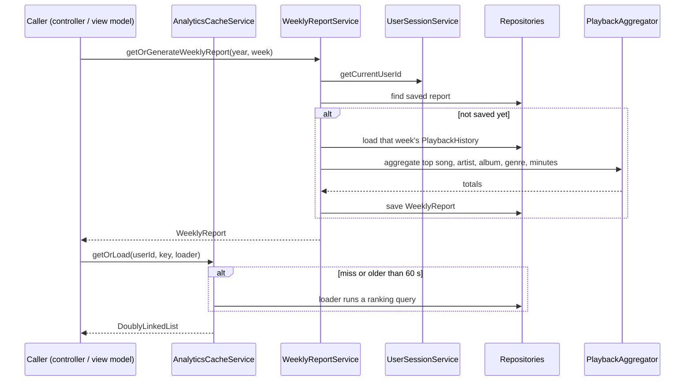

[← Back to root](../../../../../../../../README.md)

# service/handlers — analytics, reports and stat snapshots

## Behavior
These services turn the current user's `PlaybackHistory` rows into the numbers the dashboard and My Reports pages show. All of them resolve the user through `UserSessionService`.

- `DailyListeningStatsService.buildStatSnapshot()` builds the dashboard stat cards (today's minutes, session length, top song/album today and this week) using Toronto-time day and week boundaries.
- `ListeningHistoryService`, `ListeningPaginationService` and `ArtistListeningTimeService` produce the history list, ranked songs, albums and artists, and artist listening time, as `DoublyLinkedList`s or windows of them for paging; plays shorter than `PlaybackConstants.MINIMUM_PLAY_SECONDS` are skipped.
- `WeeklyReportService`, `MonthlyReportService` and `YearEndReportService` get or generate and persist a report for a period (serializable transactions), delegating the aggregation to `PlaybackAggregator`; the year service also provides top songs, top artists and monthly listening time.
- `AnalyticsCacheService` is a shared in-memory cache keyed by `userId:key` with a 60-second TTL, so one user's data never reaches another; it offers per-user, per-key and full invalidation.

## Responsibilities
- Owns aggregation, ranking, report generation/persistence and analytics caching.
- Does **not** own HTTP/JSON mapping (that is `controller/AnalyticsController` and `DashboardController`), view-model formatting (`presentation`), or recording plays (`service/PlaybackTrackingService`).

## S.O.L.I.D. principles used
- **Single Responsibility**: one service per concern, for example `ArtistListeningTimeService` only totals time per artist and `AnalyticsCacheService` only caches.
- **Dependency Inversion**: services use repositories and `UserSessionService` via injection, not concrete data access.
- **Open/Closed**: the three report services share `PlaybackAggregator`, so a new report period reuses it without changing the others.

## Code reused
- `PlaybackAggregator`, `PlaybackConstants` and `DoublyLinkedList` from `utils`.
- `PlaybackHistoryRepository`, `UserRepository`, `ArtistRepository`, `YearEndReportRepository`, and report entities.
- `UserSessionService` from `service/`.

## Table of contents
- [AnalyticsCacheService.java](AnalyticsCacheService.java) — per-user TTL cache of analytics datasets
- [ArtistListeningTimeService.java](ArtistListeningTimeService.java) — listening seconds per artist, top artists
- [DailyListeningStatsService.java](DailyListeningStatsService.java) — dashboard stat card snapshot
- [ListeningHistoryService.java](ListeningHistoryService.java) — listening history with windowed paging
- [ListeningPaginationService.java](ListeningPaginationService.java) — ranked top songs, albums and artists, full or windowed
- [MonthlyReportService.java](MonthlyReportService.java) — monthly report get or generate
- [WeeklyReportService.java](WeeklyReportService.java) — weekly report get or generate
- [YearEndReportService.java](YearEndReportService.java) — year-end report and yearly breakdowns
- [← Back to root](../../../../../../../../README.md)

## Sequence diagram

