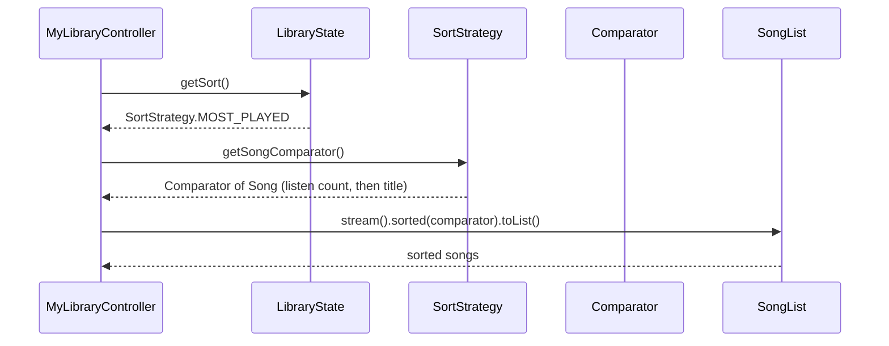

[← Back to root](../../../../../../../README.md)

# utils — shared formatting, rules, sort orders and the paginated list

## Behavior

Six classes of stateless helpers and one data structure, all used across layers:

- `AppUtils`: time formatting (`formatRelativeTime`, `formatTime` as `m:ss`, `formatDuration`) and `logError`, which writes a component-tagged message to stderr.
- `ArtistUtils`: `getPrimaryArtistName(Song)` and `getArtistName(Artist)`, which fall back to "Unknown Artist" instead of returning null.
- `PlaybackConstants`: the rule for a counted play. `MINIMUM_PLAY_SECONDS` is 20, and `isValidPlay` rejects null durations and anything shorter.
- `PlaybackAggregator`: static aggregation over a `List<PlaybackHistory>`. It filters with `isValidPlay`, then computes the valid play count, total minutes (truncated), and the top song, artist, album song and genre.
- `SortStrategy`: an enum with four constants (`ALPHABETICAL`, `REVERSE_ALPHABETICAL`, `RECENTLY_ADDED`, `MOST_PLAYED`). Each supplies a `Comparator<Song>` and a `Comparator<Album>`, and the two newer orders break ties alphabetically.
- `DoublyLinkedList<T>`: a generic doubly linked list with `add`, `addFirst`, `get` (walks from the nearer end), `getWindow(offset, limit)`, `removeFirst`, `removeLast` and `contains`. It is used for paginated results.

The desktop helpers for window sizing, dialogs and album-art views were removed. Sizing is CSS, dialogs are in `static/js/app.js`, and album art comes from `/media/art/album/{id}`.

## Responsibilities

Owns the stateless helpers and shared rules: display formatting, the artist-name fallback, what counts as a valid play, aggregation over history, sort orders, and the paginated list type.

Does not own:
- Queries and persistence: `repository/`.
- Workflows such as generating a report or importing a file: `service/`.
- View-specific objects: `dto/` and `presentation/`.
- Page rendering and sizing: templates and `static/`.

## S.O.L.I.D. principles used

- **Single Responsibility**: each class has one job, `AppUtils` for formatting and logging, `ArtistUtils` for artist names, `PlaybackConstants` for the play rule, `PlaybackAggregator` for aggregation.
- **Open/Closed**: `SortStrategy` takes a new sort order as a new enum constant that overrides the two comparator methods; callers such as `MyLibraryController` do not change.
- **Liskov Substitution**: limited to `SortStrategy`, whose constants are all used through the same `getSongComparator` and `getAlbumComparator` signatures.
- **Interface Segregation**: not applicable, there are no interfaces.
- **Dependency Inversion**: not applicable, the helpers are static and take no injected collaborators.

## Code reused

- `PlaybackConstants.isValidPlay` is called inside `PlaybackAggregator` and by services such as `DailyListeningStatsService`, `ListeningPaginationService` and `ArtistListeningTimeService`.
- `PlaybackAggregator` is called by `WeeklyReportService`, `MonthlyReportService` and `YearEndReportService`.
- `DoublyLinkedList` is used by `ListeningPaginationService` and by the top songs, albums and artists view models.
- `ArtistUtils` is used by `ListeningHistoryViewModel`, `TopSongsViewModel` and `YearEndReportViewModel`, and by several controllers.
- `AppUtils` is used by `ListeningHistoryViewModel` and `DashboardController`.
- `SortStrategy` is used by `MyLibraryController` and `LibraryState`.

## Table of contents

- [AppUtils.java](AppUtils.java) — time formatting helpers and component-tagged error logging
- [ArtistUtils.java](ArtistUtils.java) — artist display-name resolution with an "Unknown Artist" fallback
- [DoublyLinkedList.java](DoublyLinkedList.java) — generic doubly linked list used for paginated results
- [PlaybackAggregator.java](PlaybackAggregator.java) — counts, minutes and top-entity aggregation over playback history
- [PlaybackConstants.java](PlaybackConstants.java) — minimum valid play length and the play-validity check
- [SortStrategy.java](SortStrategy.java) — the four library sort orders, each with song and album comparators
- [← Back to root](../../../../../../../README.md)

## Sequence diagram

`MyLibraryController` sorts the song list of the library page with the `SortStrategy` chosen in the URL.

