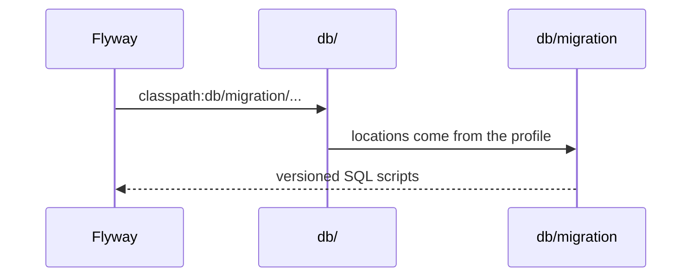

[← Back to root](../../../../README.md)

# db

## Behavior

Holds the database schema history. Flyway looks only in `migration/`; which of its subfolders it reads depends on the active profile's `spring.flyway.locations`.

## Responsibilities

- Owns schema versioning only.
- Application data, seed accounts and entity code do not belong here, and an applied migration must never be edited.

## S.O.L.I.D. principles used

Not applicable: this folder holds no logic of its own, so none of the five principles can be shown here.

## Code reused

None.

## Table of contents

- [migration/](migration/README.md)
- [← Back to root](../../../../README.md)

## Sequence diagram

