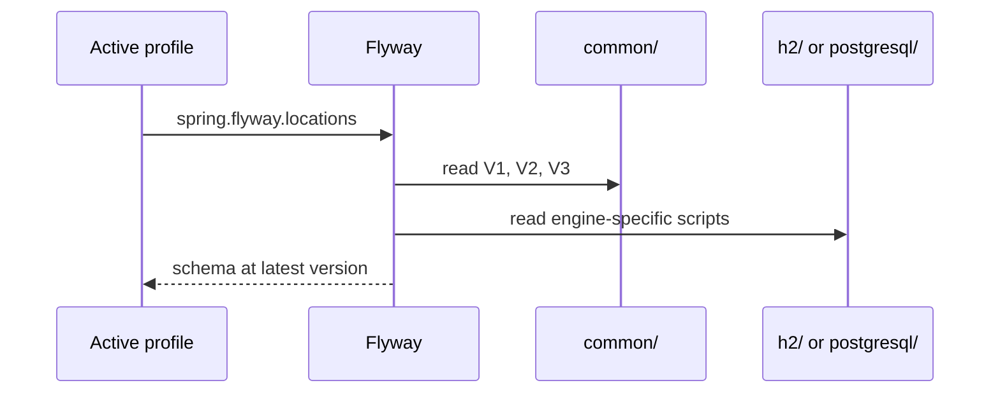

[← Back to root](../../../../../README.md)

# migration

## Behavior

Three subfolders split the SQL by database. `common/` runs on every database, `h2/` is for H2-only scripts (currently empty) and `postgresql/` is for PostgreSQL-only scripts. The embedded profile uses `common` and `h2`; the postgres profile uses `common` and `postgresql`.

## Responsibilities

- Owns the choice between shared and engine-specific migration folders.
- A script that works on both engines goes in `common/`; only use `h2/` or `postgresql/` for syntax that differs. Do not reuse a version number for different changes within the same profile's locations.

## S.O.L.I.D. principles used

Not applicable: this folder holds no logic of its own, so none of the five principles can be shown here.

## Code reused

None.

## Table of contents

- [common/](common/README.md)
- [h2/](h2/README.md)
- [postgresql/](postgresql/README.md)
- [← Back to root](../../../../../README.md)

## Sequence diagram

