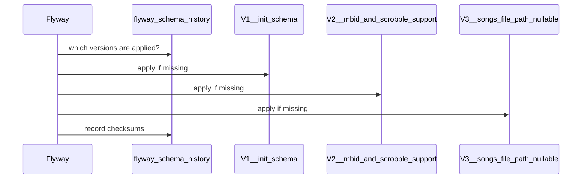

[← Back to root](../../../../../../README.md)

# common

## Behavior

Migrations applied on both H2 and PostgreSQL. `V1__init_schema.sql` creates the tables (users, artists, albums, songs, playback history and the rest) and their constraints. `V2__mbid_and_scrobble_support.sql` adds MusicBrainz ID columns, the `is_placeholder` flag on songs and `external_scrobble_id` on playback history. `V3__songs_file_path_nullable.sql` makes `songs.file_path` nullable (`ALTER COLUMN file_path DROP NOT NULL`).

## Responsibilities

- Owns SQL that is valid on both engines.
- Engine-specific syntax belongs in `h2/` or `postgresql/`; Hibernate runs with `ddl-auto=validate`, so entity changes need a new migration here, never an edit of an old one.

## S.O.L.I.D. principles used

Not applicable: this folder holds no logic of its own, so none of the five principles can be shown here. Plain SQL files.

## Code reused

None.

## Table of contents

- [V1__init_schema.sql](V1__init_schema.sql)
- [V2__mbid_and_scrobble_support.sql](V2__mbid_and_scrobble_support.sql)
- [V3__songs_file_path_nullable.sql](V3__songs_file_path_nullable.sql)
- [← Back to root](../../../../../../README.md)

## Sequence diagram

