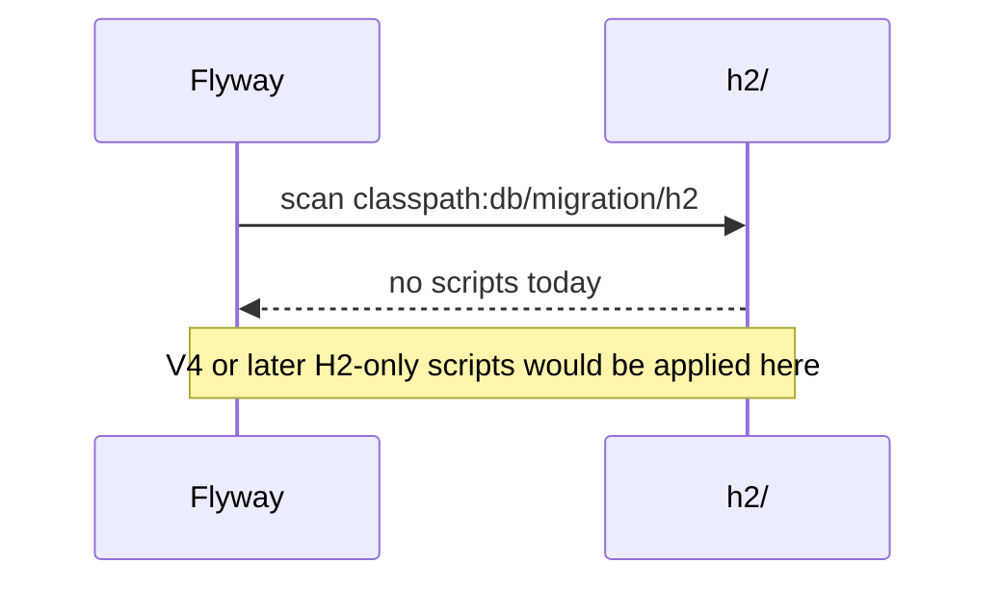

[← Back to root](../../../../../../README.md)

# h2

## Behavior

Reserved for migrations that only H2 should run. It is currently empty (no files), and the embedded profile still lists it in `spring.flyway.locations` so a script placed here is picked up automatically.

## Responsibilities

- Owns H2-only SQL, if any is ever needed.
- Scripts that work on both engines belong in `common/`.

## S.O.L.I.D. principles used

Not applicable: this folder holds no logic of its own, so none of the five principles can be shown here. The folder is empty.

## Code reused

None.

## Table of contents

- [← Back to root](../../../../../../README.md)

## Sequence diagram

