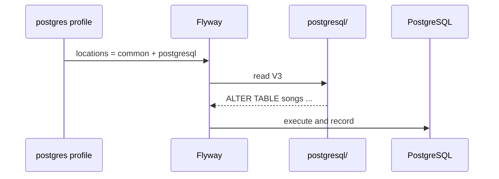

[← Back to root](../../../../../../README.md)

# postgresql

## Behavior

PostgreSQL-only migrations, read only by the `postgres` profile. It contains `V3__songs_file_path_nullable.sql` (`ALTER COLUMN file_path SET NULL`), a script with the same name and version number as `common/V3__songs_file_path_nullable.sql`. Because the postgres profile reads both `common` and `postgresql`, this duplicate version is a known hazard: Flyway rejects two scripts with the same version in its locations, so check this file before using the postgres profile.

## Responsibilities

- Owns SQL that only PostgreSQL accepts.
- Shared SQL belongs in `common/`. Never reuse a version number that exists in `common/`, because the postgres profile loads both folders.

## S.O.L.I.D. principles used

Not applicable: this folder holds no logic of its own, so none of the five principles can be shown here. A single SQL script.

## Code reused

None.

## Table of contents

- [V3__songs_file_path_nullable.sql](V3__songs_file_path_nullable.sql)
- [← Back to root](../../../../../../README.md)

## Sequence diagram

