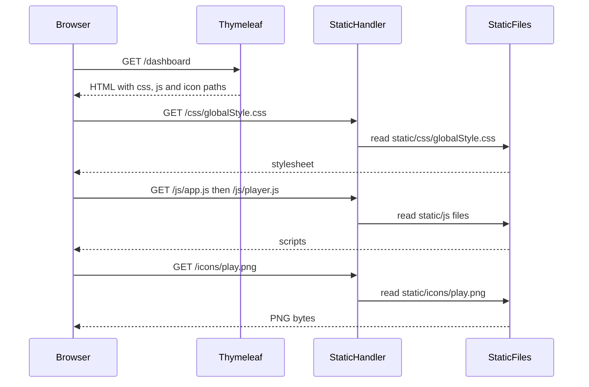

[← Back to root](../../../../README.md)

# static — browser assets

## Behavior

Holds the files the browser downloads directly, with no template or controller in between. The folder has no files of its own; it has three subfolders, and Spring Boot serves its contents from the site root, so `static/css/globalStyle.css` is requested as `/css/globalStyle.css`, `static/js/app.js` as `/js/app.js` and `static/icons/play.png` as `/icons/play.png`. The Thymeleaf pages in `templates/` reference these paths with `@{/css/...}`, `@{/js/...}` and `@{/icons/...}`. Nothing in this folder runs on the server.

## Responsibilities

- Owns: the stylesheets (`css/`), the browser scripts (`js/`) and the images (`icons/`) that the web pages use.
- Does **not** own: HTML markup (goes in `templates/`), server logic, request handling and data (goes in the Java `controller` and `service` packages under `src/main/java`), or the song files themselves (they are streamed from the library through `/media/song/{id}`, not stored here).

## S.O.L.I.D. principles used

Not applicable — no logic in this folder. It only groups asset folders; the principles that apply are described in the README of each subfolder (`css/`, `js/`, `icons/`).

## Code reused

None at this level. The subfolders reuse each other: every page loads `css/globalStyle.css`, `css/buttons.css` and `css/musicPlayer.css`, and every page script relies on `js/app.js` (and `js/player.js` for playback).

## Table of contents

- [css/](css/README.md) — stylesheets: shared base, buttons, player and one sheet per page
- [js/](js/README.md) — shared helpers (`app.js`, `player.js`) and one script per page
- [icons/](icons/README.md) — PNG, SVG and ICNS images served at `/icons/...`
- [← Back to root](../../../../README.md)

## Sequence diagram

