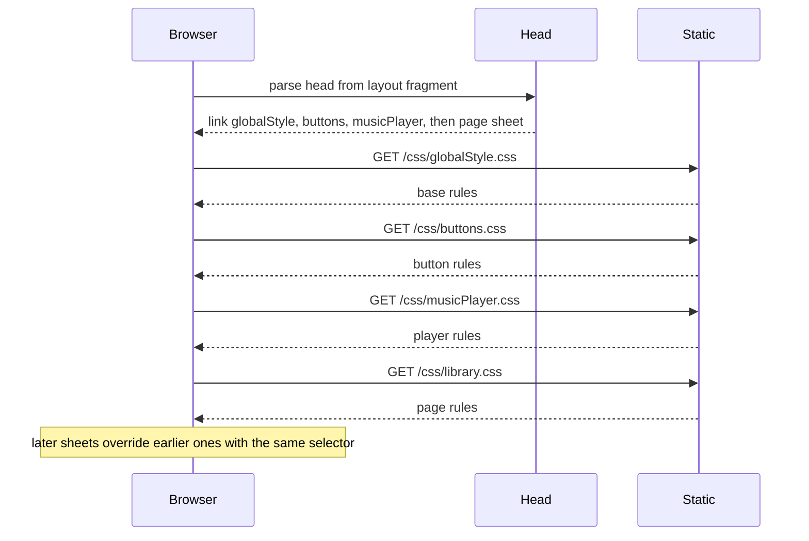

[← Back to root](../../../../../README.md)

# css — web stylesheets

## Behavior

Web translations of the desktop JavaFX stylesheets. File names and class names match the desktop app, and the JavaFX `-fx-*` properties are rewritten as plain CSS. `templates/fragments/layout.html` loads three sheets on every page, in this order: `globalStyle.css` (reset, typography and shared utility classes), `buttons.css` (every button and combo-box style) and `musicPlayer.css` (the player panel). Each page then adds its own sheets through the `links` parameter of the `head` fragment. The files are:

- `globalStyle.css` — reset, text sizes and colours, panels, sidebar and shared utility classes (`txt-*`, `dark-table`, `dark-page-bg`, `dropZone`); loaded everywhere.
- `buttons.css` — single source for button and combo-box styles (`green-btn`, `btn-red`, `view-All`, `month-btn`, `player-btn`); loaded everywhere.
- `musicPlayer.css` — the player panel in its two sizes (`now-playing-bar`, `player-large`, `player-small`); loaded everywhere.
- `dashboard.css` — dashboard panels (`panels`) and their layout.
- `graph.css` — the listening chart; the SVG elements drawn by `dashboard.js` carry the desktop class names.
- `analytics.css` — row labels and rows of the My Reports lists.
- `reports.css` — page layout shared by the My Reports sections (`year-selector`).
- `wrapped.css` — the Yearly Wrapped slideshow (`wrapped-view`, `wrapped-slides`).
- `library.css` — My Library: album and artist detail headers, grids, lists and the top bar.
- `playlist.css` — the My Playlist page layout (`playlist-page`, `playlist-content`).
- `import.css` — the Import Music page (`import-page`).
- `login.css` — the sign-in page (`main-background`, `login-page`, `login-card`).

## Responsibilities

- Owns: how things look — colours, sizes, spacing, layout and the visual states of the page parts.
- Does **not** own: markup (goes in `templates/`), behaviour such as clicks, timers or the chart drawing (goes in `static/js/`), or the data shown (comes from the controllers). A new page gets its own sheet here, and shared classes go in `globalStyle.css` or `buttons.css`, not copied into page sheets.

## S.O.L.I.D. principles used

Not applicable — no logic in this folder. These files are declarative style rules with no behaviour to extend or substitute.

## Code reused

Shared classes are reused across pages. `globalStyle.css` and `buttons.css` apply to every page. `dashboard.css` and `analytics.css` are loaded by both `dashboard.html` and `analytics.html`, `wrapped.css` and `reports.css` by `analytics.html`, and `graph.css` by `dashboard.html`. The sheets are reused by reference through the `<link>` tags in the templates, not by import.

## Table of contents

- [globalStyle.css](globalStyle.css) — reset, text, panels and shared utility classes (every page)
- [buttons.css](buttons.css) — all button and combo-box styles (every page)
- [musicPlayer.css](musicPlayer.css) — player panel in its large and small sizes (every page)
- [dashboard.css](dashboard.css) — dashboard panels and layout
- [graph.css](graph.css) — listening chart layout and series colours
- [analytics.css](analytics.css) — My Reports list rows
- [reports.css](reports.css) — My Reports page layout and year selector
- [wrapped.css](wrapped.css) — Yearly Wrapped slideshow
- [library.css](library.css) — My Library layout, grids and lists
- [playlist.css](playlist.css) — My Playlist layout
- [import.css](import.css) — Import Music layout
- [login.css](login.css) — sign-in page layout
- [← Back to static](../README.md)
- [← Back to root](../../../../../README.md)

## Sequence diagram

