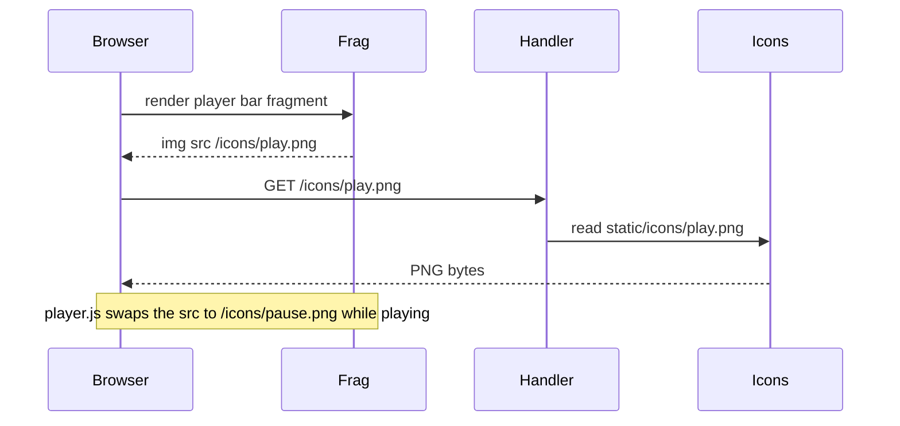

[← Back to root](../../../../../README.md)

# icons — images

## Behavior

Image files served at `/icons/...` by Spring's static resource handler. The four player controls are used by the web pages: `play.png` (shown on the play button in `templates/fragments/player.html`), `pause.png` (swapped in by `static/js/player.js` while a song plays), and `prev.png` and `next.png` (previous and next buttons in the same fragment). The other files are not referenced by any template, script or stylesheet in the project today; they are kept from the desktop app's icon set, and the file names describe what they show.

## Responsibilities

- Owns: the image files the web pages display.
- Does **not** own: icon drawing code, labels or the logic that decides when an icon shows (that is in `templates/` and `static/js/`). To add an icon, put the file here and reference it as `/icons/<file name>`.

## S.O.L.I.D. principles used

Not applicable — no logic in this folder. It contains only image files.

## Code reused

None in code terms. Four files (`play.png`, `pause.png`, `prev.png`, `next.png`) are referenced by name from `templates/fragments/player.html` and `static/js/player.js`.

## Table of contents

- [MusicDashboard.icns](MusicDashboard.icns) — macOS app icon of the desktop app (not used by the web pages)
- [eject.png](eject.png) — eject symbol (not used by the web pages)
- [file-audio-regular.png](file-audio-regular.png) — outlined audio file icon (not used by the web pages)
- [file-audio-solid.png](file-audio-solid.png) — filled audio file icon (not used by the web pages)
- [heart-regular.png](heart-regular.png) — outlined heart, favourite state off (not used by the web pages)
- [heart-solid.png](heart-solid.png) — filled heart, favourite state on (not used by the web pages)
- [itunes-brands-solid-full.svg](itunes-brands-solid-full.svg) — iTunes brand logo (not used by the web pages)
- [next.png](next.png) — next-track button in the player
- [pause.png](pause.png) — pause button, shown while a song plays
- [play.png](play.png) — play button in the player
- [prev.png](prev.png) — previous-track button in the player
- [repeat-solid.png](repeat-solid.png) — repeat symbol (not used by the web pages)
- [shuffle-solid.png](shuffle-solid.png) — shuffle symbol (not used by the web pages)
- [spotify-brands-solid-full.svg](spotify-brands-solid-full.svg) — Spotify brand logo (not used by the web pages)
- [← Back to static](../README.md)
- [← Back to root](../../../../../README.md)

## Sequence diagram

