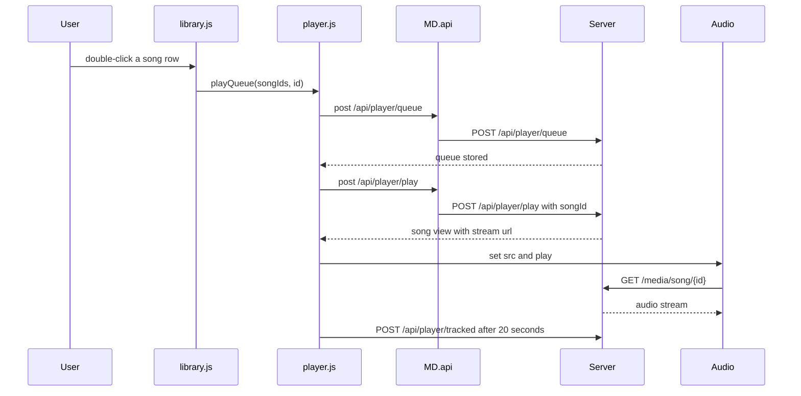

[← Back to root](../../../../../README.md)

# js — browser scripts

## Behavior

Plain browser JavaScript with no framework and no build step. Two shared scripts load on every page, in this order: `app.js` defines `window.MD` (`api`, `toast`, `modal`, `menu`, `fmt`, `esc`, `artUrl`, `el`, `touch`, `drawer`), and `player.js` defines `MD.player`, which drives one HTML5 audio element, calls `/api/player/*` and streams from `/media/song/{id}`. Each page then loads at most one script of its own:

- `app.js` — shared helpers: JSON requests with the CSRF header and session-expiry redirect, toasts, dialogs, popup menus, time formatting and HTML escaping. It also detects touch input (`MD.touch.coarse()` and `MD.touch.isTap(event)`) and opens the sidebar as a drawer below 1280px (`MD.drawer` with `open`, `close` and `toggle`). The drawer closes on Escape, on a backdrop tap, or when the window reaches desktop width.
- `player.js` — the player: play, queue, next and previous, seek, play tracking, and restoring the player state after a page load.
- `dashboard.js` — My Dashboard: draws the listening chart as SVG, fills the stat cards and refreshes them when the song changes. The chart shows every second month label when it is narrow, and a single tap plays a Recently Played row on touch devices.
- `library.js` — My Library: genre and sort controls, alphabet bar, double-click to play (a single tap on touch devices), a "⋯" button on album cards and rows that opens the same Edit Album and Delete Album menu as right-click, song menu and the edit and delete dialogs.
- `playlist.js` — My Playlist: New, Rename and Delete dialogs, Play All, and removing a song from the playlist. A single tap plays a song row on touch devices, and song rows and cards have a "⋯" button that opens the same Play and Remove from Playlist menu as right-click.
- `analytics.js` — My Reports: year selector, clickable rows, "View All" paged modals and the Yearly Wrapped slideshow.
- `import.js` — Import Music: folder scan and drag-and-drop upload, then polls `/api/import/jobs/{jobId}` to show progress and results.
- `login.js` — sign-in page: disables the button while signing in and rejects empty fields.

## Responsibilities

- Owns: what happens in the browser when the user acts — clicks, dialogs, polling, drawing the chart and driving playback.
- Does **not** own: markup (goes in `templates/`), colours and layout (goes in `static/css/`), or server logic and stored data (goes in the Java controllers and services). Helpers that more than one page needs belong in `app.js` or `player.js`, not copied into a page script. `fetch` is called only inside `app.js`.

## S.O.L.I.D. principles used

- **Single Responsibility**: each script owns one page, and `app.js` and `player.js` each own one concern (generic helpers; playback).
- **Open/Closed**: `analytics.js` keeps its paged lists in one `MODALS` table, so a new list is added as one entry without changing the modal code.
- **Dependency Inversion**: page scripts depend on `MD.api`, `MD.toast`, `MD.modal` and `MD.player` rather than on `fetch` or the audio element directly, so the transport and playback details can change inside the shared files.

## Code reused

- Every page script reuses `window.MD` from `app.js` (for example `MD.api`, `MD.el`, `MD.fmt`, `MD.modal`, `MD.menu`). `library.js`, `playlist.js` and `dashboard.js` reuse `MD.touch.isTap` so that a single tap plays a row on touch devices.
- `player.js` reuses `MD.api`, `MD.toast` and `MD.fmt` from `app.js`.
- `dashboard.js`, `library.js`, `playlist.js` and `analytics.js` reuse `MD.player` to start playback and listen for `md:songchange`.
- `import.js` reuses `MD.api.upload` for the multipart upload.

## Table of contents

- [app.js](app.js) — shared `window.MD` helpers, touch detection and sidebar drawer (loaded on every page)
- [player.js](player.js) — `MD.player` playback and audio control (loaded on every page)
- [dashboard.js](dashboard.js) — My Dashboard chart, stat cards, refresh and touch taps
- [library.js](library.js) — My Library interactions, album menus, touch taps and playback
- [playlist.js](playlist.js) — My Playlist dialogs, song menus, touch taps and playback
- [analytics.js](analytics.js) — My Reports lists, modals and wrapped slideshow
- [import.js](import.js) — Import Music scan, upload and progress
- [login.js](login.js) — sign-in page feedback
- [← Back to static](../README.md)
- [← Back to root](../../../../../README.md)

## Sequence diagram

