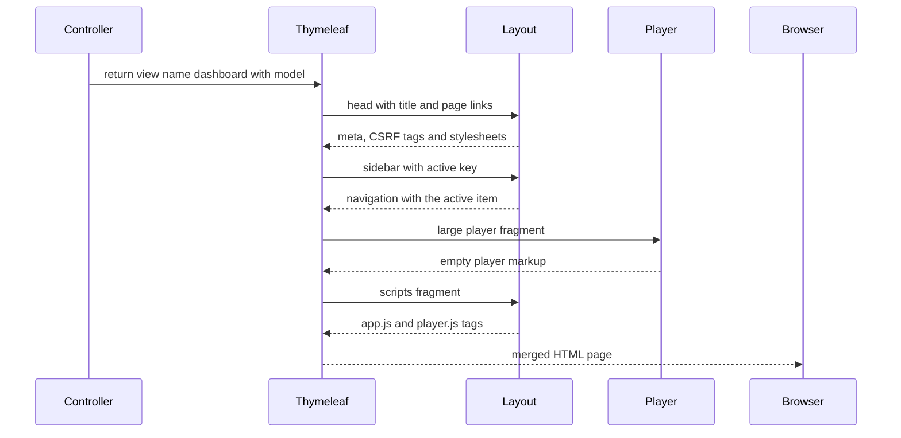

[← Back to root](../../../../README.md)

# templates — Thymeleaf pages

## Behavior

One Thymeleaf template per page. A controller returns a view name, and Thymeleaf merges that page with the shared fragments and returns HTML. Each page names its `<head>` through `fragments/layout :: head(...)` (which also brings in the global and player stylesheets), its sidebar through `layout :: sidebar('<key>')`, and its player through `fragments/player :: bar` or `:: large`. The pages are `login`, `dashboard`, `library`, `playlist`, `import`, `analytics`, `settings` and `error`.

Two pages are assembled from subfolders. `library.html` picks one pane by the model attribute `pane` (`library/topbar`, then `library/songs`, `albums`, `artists`, `favourites` and the detail panes). `analytics.html` picks one section by the `report` parameter with `th:case` (`analytics/history`, `songs`, `albums`, `artists`, `weekly`, `monthly` or `yearly`, history being the default). `analytics.html` has its own sidebar, so it includes `mobileBar` and `sidebarBackdrop` itself and gives its `<aside>` the id `app-sidebar`. `settings.html` is a placeholder that shows only its title and the player bar. `error.html` shows the status, the error and the message, with a link back to the dashboard.

## Responsibilities

- Owns: the HTML structure of each page and the choice of which shared fragment appears where.
- Does **not** own: loading or computing data (goes in the Java controllers and services under `src/main/java/com/sebastiandorata/musicdashboard`), styling (goes in `static/css/`), or client behaviour such as clicks, dialogs and playback (goes in `static/js/`). If the same markup is needed on two pages, it becomes a fragment in `fragments/` or `library/` or `analytics/`, not a copy.

## S.O.L.I.D. principles used

- **Single Responsibility**: each file has one job. `fragments/layout.html` holds only page chrome, `fragments/player.html` only the player markup, and each library or analytics view has its own file.
- **Open/Closed**: adding a library pane or an analytics report means a new fragment file plus one `th:case` line in its page, and the other panes are not touched.
- **Interface Segregation**: each fragment exposes only the variant a caller needs, such as `player :: large` for the dashboard and `player :: bar` elsewhere, or `layout :: sidebarTitle` for pages with their own sidebar.

## Code reused

- Every page reuses `fragments/layout.html`: `head` on all pages, `sidebar` on all except `login.html` and `error.html`, and `scripts` on every page except `login.html` and `error.html`.
- The pages that show a player reuse `fragments/player.html :: bar`; `dashboard.html` uses `:: large` instead.
- `library.html` reuses `library/topbar.html` and the pane fragments; the pane fragments reuse `library/shared.html` for album cards, rows and the alphabet bar.
- `analytics.html` reuses the `analytics/*.html` section fragments; `weekly.html` and `monthly.html` reuse `analytics/reportCard.html` for the report card.

## Table of contents

- [login.html](login.html) — sign-in page (two cards side by side)
- [dashboard.html](dashboard.html) — My Dashboard: large player, stat cards, recently played, chart and top artists
- [library.html](library.html) — My Library shell that renders one pane chosen by `pane`
- [playlist.html](playlist.html) — My Playlist page showing the selected playlist in grid or list mode, with a "⋯" menu button on each song row and card
- [import.html](import.html) — Import Music page with scan and drop zone
- [analytics.html](analytics.html) — My Reports page that renders one section chosen by `report`
- [settings.html](settings.html) — placeholder Settings page
- [error.html](error.html) — error page with status, message and a link to the dashboard
- [fragments/](fragments/README.md) — shared layout and player fragments
- [library/](library/README.md) — library panes and shared library pieces
- [analytics/](analytics/README.md) — My Reports sections and the report card
- [← Back to root](../../../../README.md)

## Sequence diagram

