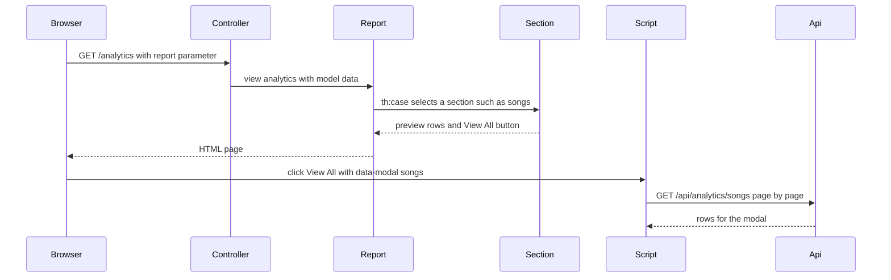

[← Back to root](../../../../../README.md)

# analytics — My Reports sections

## Behavior

Fragments for the My Reports page. `templates/analytics.html` renders one section per request, chosen by the `report` parameter with `th:case`, and the `*` branch falls back to history. Each section is a `section` fragment in its own file:

- `history.html` — Listening History: 20 rows; "View Full History" opens the paged modal (25 per page).
- `songs.html` — Top Songs: 20 rows; "View All" opens the paged modal (10 per page).
- `albums.html` — Top Albums: 20 rows; "View All" opens the paged modal (10 per page).
- `artists.html` — Top Artists: 20 rows, padded with dashes when there are fewer; "View All" opens the paged modal (20 per page).
- `weekly.html` — Weekly Summary: a month calendar with Sunday-to-Saturday weeks; clicking a day shows that week's report card.
- `monthly.html` — Monthly Summary: twelve month buttons and the selected month's report card.
- `yearly.html` — Yearly Wrapped: a slideshow of ten gradient slides with arrows and dots.
- `reportCard.html` — the `card(card)` fragment, the weekly and monthly report card shown by `weekly.html` and `monthly.html`.

Each "View All" button carries a `data-modal` value (`history`, `songs`, `albums` or `artists`) and each preview row carries its song or album id. `static/js/analytics.js` reads those attributes to open the modal and to play or open the row.

## Responsibilities

- Owns: the HTML of each My Reports section and the report card.
- Does **not** own: calculating the listening figures (goes in the Java analytics controller and services), the modal paging, hover and slideshow behaviour (goes in `static/js/analytics.js`), or styles (go in `static/css/analytics.css`, `reports.css` and `wrapped.css`). A new report gets its own section file here and one `th:case` branch in `analytics.html`.

## S.O.L.I.D. principles used

- **Single Responsibility**: each section file draws one report, and the report card has its own file so both period views can reuse it.
- **Open/Closed**: adding a report means a new section file and one `th:case` line; the other sections are unchanged.

## Code reused

- `weekly.html` and `monthly.html` reuse `reportCard.html` (`card(card)`).
- The section files reuse the page's `analytics-title` and `analytics-list-item` classes from `static/css/analytics.css`, and `view-All` and `month-btn` from `buttons.css`.
- The "View All" modals reuse `MD.modal` from `static/js/app.js`, driven by the `MODALS` table in `analytics.js`.

## Table of contents

- [history.html](history.html) — Listening History preview and full-history modal
- [songs.html](songs.html) — Top Songs preview and modal
- [albums.html](albums.html) — Top Albums preview and modal
- [artists.html](artists.html) — Top Artists preview and modal
- [weekly.html](weekly.html) — weekly calendar and week report
- [monthly.html](monthly.html) — month buttons and month report
- [yearly.html](yearly.html) — Yearly Wrapped slideshow
- [reportCard.html](reportCard.html) — report card fragment used by weekly and monthly
- [← Back to templates](../README.md)
- [← Back to root](../../../../../README.md)

## Sequence diagram

