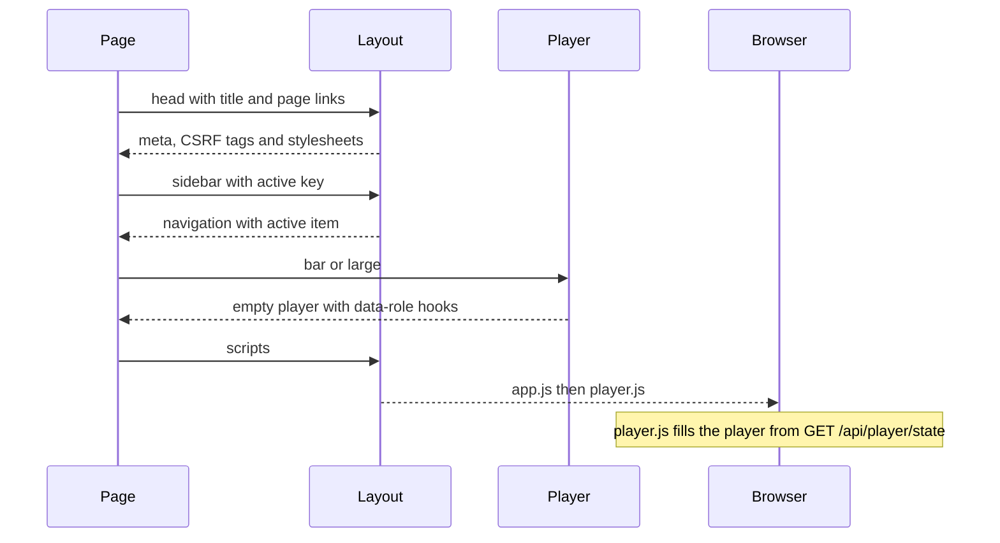

[← Back to root](../../../../../README.md)

# fragments — shared page parts

## Behavior

Thymeleaf fragments that several pages include with `th:replace`. `layout.html` provides the shared web shell: `head(title, links)` writes the meta tags, the CSRF tags, the global, button and player stylesheets, and then the page's own `links`; `sidebar(active)` writes the navigation with the item for the current page marked active (keys `dashboard`, `library`, `playlist`, `import`, `analytics`, `settings`); `sidebarTitle` writes only the title block for pages with their own sidebar; `mobileBar` writes the top bar with the menu button (shown below 1280px) and `sidebarBackdrop` writes the dimmed layer behind the open drawer. `sidebar(active)` emits `mobileBar` before the navigation and `sidebarBackdrop` after it, and the navigation has the id `app-sidebar`; and `scripts` loads `app.js` and then `player.js`. `player.html` provides the music player in two variants, `large` (the 280 px art panel on the dashboard) and `bar` (the small bar at the bottom of the other pages). Both roots carry a `data-player` attribute and inner `data-role` hooks, and they render an empty state ("No song playing") that `static/js/player.js` fills in from `GET /api/player/state`.

## Responsibilities

- Owns: the page chrome and the player markup that every page shares.
- Does **not** own: markup that belongs to a single page (goes in `templates/*.html`), the player's behaviour (goes in `static/js/player.js`), or styles (goes in `static/css/`). A new piece of chrome used by more than one page goes here; one used by a single page stays in that page.

## S.O.L.I.D. principles used

- **Single Responsibility**: `layout.html` only builds the page shell and `player.html` only builds the player; neither renders page content.
- **Interface Segregation**: callers include only the variant they need, `player :: large` or `player :: bar`, and `layout :: sidebarTitle` or the full `sidebar(active)`.

## Code reused

Every page in `templates/` includes `layout.html`. The player fragments are reused across pages: `dashboard.html` includes `player :: large`, and `library.html`, `analytics.html`, `playlist.html`, `import.html` and `settings.html` include `player :: bar`. The `data-role` hooks in the player markup are the same ones `static/js/player.js` binds on every page.

## Table of contents

- [layout.html](layout.html) — shared `head`, `sidebar`, `sidebarTitle`, `mobileBar`, `sidebarBackdrop` and `scripts` fragments
- [player.html](player.html) — `large` and `bar` music player fragments
- [← Back to templates](../README.md)
- [← Back to root](../../../../../README.md)

## Sequence diagram

