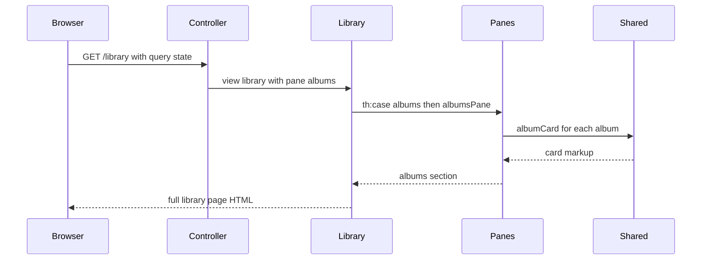

[← Back to root](../../../../../README.md)

# library — My Library panes

## Behavior

Fragments for the My Library page. `templates/library.html` includes `topbar.html` once, then renders one pane chosen by the model attribute `pane`. Each pane is a named Thymeleaf fragment in its own file:

- `topbar.html` — `topbar`: title row with the Dashboard link, the tab buttons, the list and grid toggles, and the genre and sort controls.
- `songs.html` — `songsPane`: all songs grouped A–Z with the alphabet bar.
- `albums.html` — `albumsPane`: albums as a card grid, or as an A–Z list with the alphabet bar.
- `album-detail.html` — `albumDetailPane`: back link, artwork, title, artist and the album's songs.
- `artists.html` — `artistsPane`: artists grouped A–Z with the alphabet bar.
- `artist-detail.html` — `artistDetailPane`: back link, artist name and the artist's albums as a grid or list.
- `favourites.html` — `favouritesPane`: header, an empty-state message when there are no favourites, otherwise a list or card grid.
- `shared.html` — reusable pieces: `alphabetBar`, `albumArt`, `albumCard`, `albumRow`, `albumRowPlain` and `songRow`. `albumCard(a, editable)` and `albumRow(a, editable)` wrap the card or row in a `div` (`library-card-wrap` or `library-row-wrap`) that also holds the "⋯" album menu button when `editable` is true. `albums.html` passes `true` and `artist-detail.html` passes `false`.

The view state is the URL query string, so each pane is rendered from the server with the current tab, mode and filters. The row and card markup carries the data attributes that `static/js/library.js` uses for double-click playback and the context menus.

## Responsibilities

- Owns: the HTML of each My Library tab and view, and the shared pieces they are built from.
- Does **not** own: reading the query string or choosing which songs and albums to show (goes in the Java `MyLibraryController` and the view-state class it uses), playback and edit dialogs (go in `static/js/library.js`), or styles (go in `static/css/library.css`). A new tab gets its own pane file here; markup used by more than one pane goes in `shared.html`.

## S.O.L.I.D. principles used

- **Single Responsibility**: one file per pane, so changing the album detail view never touches the songs list.
- **Open/Closed**: a new view is added as a new pane file plus one `th:case` branch in `library.html`; the existing panes do not change.
- **Interface Segregation**: `shared.html` exposes small separate fragments (`albumCard`, `albumRow`, `songRow`, ...), so each pane includes only the piece it draws.

## Code reused

- `library.html` reuses `topbar.html` and each pane fragment.
- The panes reuse `shared.html`: `albumCard` in the albums grid and the artist detail, `albumRow` in the albums list, `albumRowPlain` in the artist detail, `songRow` in the songs list, `songCard` in favourites, `albumArt` in the album detail, and `alphabetBar` in the albums, artists and songs lists.
- `favourites.html` reuses the `songList` fragment defined in `songs.html`.
- Page styles come from `static/css/library.css`, `buttons.css` and `globalStyle.css`.

## Table of contents

- [topbar.html](topbar.html) — library title, tabs, list/grid toggles, genre and sort
- [songs.html](songs.html) — All Songs pane (A–Z list)
- [albums.html](albums.html) — All Albums pane (card grid or A–Z list)
- [album-detail.html](album-detail.html) — single album: artwork and song list
- [artists.html](artists.html) — All Artists pane (A–Z list)
- [artist-detail.html](artist-detail.html) — single artist: albums as grid or list
- [favourites.html](favourites.html) — Favourites pane with empty state
- [shared.html](shared.html) — reusable alphabet bar, album art, cards and rows, with the album "⋯" menu wrappers
- [← Back to templates](../README.md)
- [← Back to root](../../../../../README.md)

## Sequence diagram

