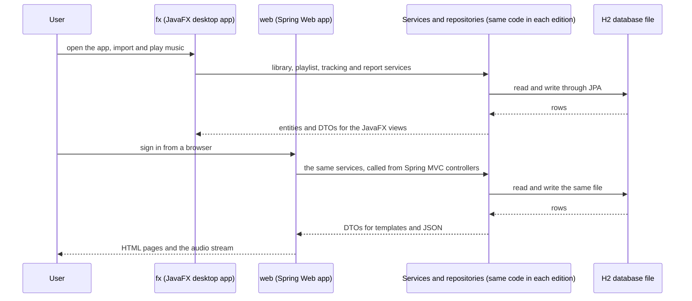

# MusicDashboard

A personal music-library application: import your own audio files, browse them by song, album and artist, build playlists, play music, and see your listening statistics. This repository holds two editions of it.

| Folder | Edition | Runs as |
|---|---|---|
| [fx](fx/README.md) | The original JavaFX desktop application | a desktop window |
| [web](web/README.md) | The Spring Web edition | a site in your browser |

## Table of contents

- [fx](fx/README.md): the JavaFX desktop edition, with its source, changelog, diagrams and design documents
- [web](web/README.md): the Spring Web edition, with its source, Docker files and generated Javadoc
- [docs](docs/index.html): the generated Javadoc of the desktop edition, published as a website (see [Why docs is at the root](#why-docs-is-at-the-root))
- [Project overview](#project-overview)
- [Sequence diagram](#sequence-diagram)
- [Dependencies](#dependencies)
- [Tech stack](#tech-stack)
- [Getting started](#getting-started)
- [Why docs is at the root](#why-docs-is-at-the-root)
- [References](#references)

## Project overview

MusicDashboard began as a desktop application: a JavaFX1 client on top of a Spring Boot2 back end that provides dependency injection, JPA persistence and Flyway migrations. That edition lives in [fx](fx/README.md), and its README describes the architecture, the design principles behind it and the coursework it grew out of.

The [web](web/README.md) edition is a second copy of the same application in which the JavaFX client layer is replaced by Spring MVC controllers, Thymeleaf templates and plain JavaScript and CSS. Audio plays in the browser, sign-in uses Spring Security, and the pages work on phones as well as desktops.

Each edition is a complete, separate Maven project with its own `pom.xml` and its own copy of the entity, repository, service and DTO code. Those copies are deliberately the same: the web edition changed only the classes its different client required. Neither folder depends on the other, so either can be built, run or removed on its own.

Both editions use the same database by default: an H2 file at `~/.musicdashboard/data/musicdashboard`, opened in H2's automatic mixed mode3, which is designed to let more than one process use the file. A library imported in one edition, and the accounts and listening history that go with it, are therefore visible in the other.

## Sequence diagram

How the two editions reach the same data:

## Dependencies

Taken from [fx/pom.xml](fx/pom.xml) and [web/pom.xml](web/pom.xml). "Managed" means the version comes from the Spring Boot 4.0.3 parent.

| Dependency | Version | Used by | Purpose |
|---|---|---|---|
| spring-boot-starter-data-jpa, spring-boot-starter-jdbc | managed | both | Repositories, Hibernate and the connection pool |
| spring-boot-starter-security | managed (Spring Security 7.0.4) | both | Password hashing; form login in the web edition |
| spring-boot-starter-flyway | managed | both | Database schema migrations |
| spring-boot-devtools | managed | both | Automatic restart during development |
| h2 | 2.3.232 | both | The embedded database, used by default |
| postgresql | managed | both | Driver for the optional PostgreSQL profile |
| lombok | managed | both | Boilerplate reduction |
| jaudiotagger (com.github.RouHim) | 2.0.16 | both | Reading audio tags and embedded cover art |
| jna | 5.19.1 | both | Native access library |
| javafx-controls, javafx-graphics, javafx-base, javafx-media | 25.0.2 | fx | The desktop user interface and audio playback |
| spring-boot-starter-webmvc | managed | web | Spring MVC and the embedded web server |
| spring-boot-starter-thymeleaf | managed | web | Server-side HTML templates |

Each edition's README lists its own dependencies in more detail.

## Tech stack

- Java 25 and Maven, in both editions
- Spring Boot 4.0.3, Spring Data JPA with Hibernate, Flyway
- H2 file database by default, PostgreSQL optionally
- Desktop edition: JavaFX 25
- Web edition: Spring MVC, Spring Security 7, Thymeleaf, plain JavaScript and CSS, optional Docker packaging

## Getting started

- **Desktop edition:** see [fx/README.md](fx/README.md). The IntelliJ run configuration is in `fx/.run`.
- **Web edition:** see [web/README.md](web/README.md). In short, from the `web` folder, `mvn spring-boot:run` and open `http://localhost:8080`, or `docker compose up --build`.
- **In IntelliJ IDEA:** open this root folder and load `fx/pom.xml` and `web/pom.xml` as two Maven projects.

## Why docs is at the root

[docs](docs/index.html) holds the generated Javadoc of the desktop edition. It is published at <https://sebastiandorata.github.io/MusicDashboard/> by GitHub Pages, which can publish only from the root of a branch or from a `/docs` folder4. Moving it into `fx` would take the site offline, so it stays here.

The web edition's Javadoc is in [web/docs](web/docs/README.md) and is not published.

## References

1. JavaFX. https://openjfx.io/
2. Spring Boot reference. https://docs.spring.io/spring-boot/
3. H2, automatic mixed mode. https://www.h2database.com/html/features.html#auto_mixed_mode
4. GitHub Docs, configuring a publishing source for your GitHub Pages site. https://docs.github.com/en/pages/getting-started-with-github-pages/configuring-a-publishing-source-for-your-github-pages-site
