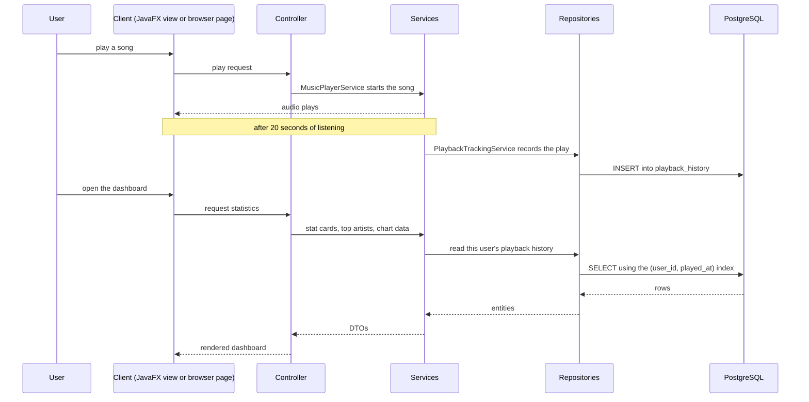
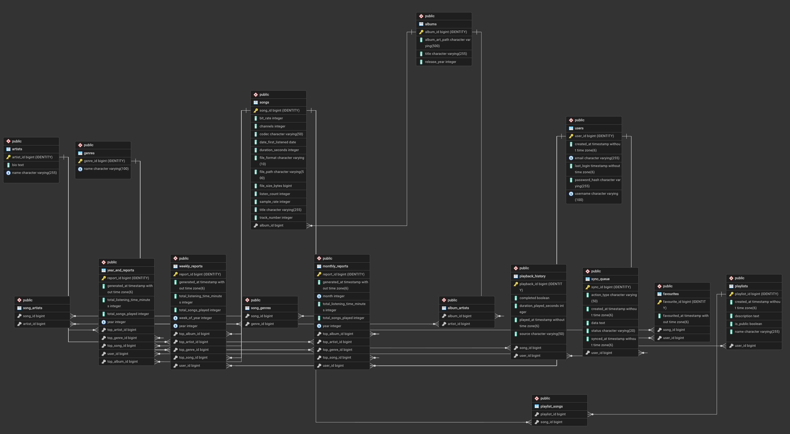

# MusicDashboard

[](https://www.linkedin.com/in/sebastian-dorata-5013b6297/)

MusicDashboard is a personal music-library application. It imports your own audio files, lets you browse and play them, and turns what you listen to into statistics and reports. It is written in Java on Spring Boot and PostgreSQL, and comes in two editions that share one data model and one set of business rules: a JavaFX desktop application and a Spring Web application that runs in the browser.

It was built as the final project for ITEC 4010, Systems Analysis and Design II.

| Folder | Edition | Runs as |
|---|---|---|
| [fx](fx/README.md) | The original JavaFX desktop application | a desktop window |
| [web](web/README.md) | The Spring Web edition | a site in your browser, on desktop or phone |

## Table of contents

Folders:

- [fx](fx/README.md): the JavaFX desktop edition, with its source, changelog, diagrams and design documents
- [web](web/README.md): the Spring Web edition, with its source, Docker files and generated Javadoc
- [docs](docs/index.html): the generated Javadoc of the desktop edition, published as a website (see [Why docs is at the root](#why-docs-is-at-the-root))

Sections:

- [What it does](#what-it-does)
- [System architecture](#system-architecture)
- [Sequence diagram](#sequence-diagram)
- [Design principles](#design-principles)
- [Database](#database)
- [Human-computer interaction principles](#human-computer-interaction-principles)
- [Privacy and security by design](#privacy-and-security-by-design)
- [Known limitations and prototype scope](#known-limitations-and-prototype-scope)
- [Tech stack](#tech-stack)
- [Dependencies](#dependencies)
- [Getting started](#getting-started)
- [Documentation](#documentation)
- [Academic background](#academic-background)
- [Why docs is at the root](#why-docs-is-at-the-root)
- [References](#references)

## What it does

- **Import.** Point it at a folder, or drag files in, and it reads every `.mp3` and `.m4a` file: title, artist, album, genre, year, track number and embedded cover art. Files are recognised by a content fingerprint, so re-importing a library updates moved or re-tagged files instead of duplicating them.
- **Library.** Browse by song, album, artist or favourites, as a grid or a list. Sort alphabetically, by most recently added or by most played, filter by genre, and jump through an A to Z index. Song and album details can be edited in place.
- **Playback.** A queue with shuffle, next, previous and seeking. A play counts toward your statistics once you have listened for 20 seconds.
- **Playlists.** Create, rename and delete playlists, and add or remove songs.
- **Dashboard.** What is playing now, today's listening time and average session length, the top song and album of the day and of the week, recently played songs, your five most-played artists, and a chart of listening hours by month that compares the current year with the previous year and with your best year.
- **Reports.** Full listening history, a weekly summary picked from a calendar, a monthly summary, a year-end "Wrapped" presentation, and ranked lists of your top songs, albums and artists.
- **Accounts.** Sign-up and sign-in with hashed passwords and escalating lockouts against password guessing. Listening history, favourites, playlists and reports belong to the signed-in user.

## System architecture

Both editions use the same N-tier architecture: the system is separated into layers, each with one clearly defined responsibility. A change to the user interface cannot reach into database logic, and the rules of the application live in one place instead of being scattered across screens and queries.

| Layer | Desktop edition (`fx`) | Web edition (`web`) | Responsibility |
|---|---|---|---|
| **Client** | JavaFX<sup>1</sup> views | Thymeleaf pages with plain JavaScript and CSS | What the user sees and interacts with |
| **Controller** | Spring-managed JavaFX controllers | Spring MVC controllers | Turns user actions into calls on the service layer |
| **Service** | Spring services | The same services | Every business rule and validation |
| **DTO** | Read-only records and view models | The same | Purpose-built snapshots that expose only what a screen needs |
| **Model** | Hibernate JPA entities | The same | Maps database tables to Java objects |
| **Database** | PostgreSQL | PostgreSQL | Relational storage |

**Client layer.** The desktop edition draws its dashboards, analytics panels and playlists with JavaFX. The web edition renders the same screens as HTML on the server and adds small scripts for playback, dialogs and live updates.

**Controller layer.** Controllers receive user actions and route them to the right service. On the desktop they assemble scenes and handle navigation between them; on the web they map URLs to pages and JSON endpoints.

**Service layer.** All business logic and validation lives here. In the desktop edition, long-running services such as import and playback tracking run on background threads and hand their results back to the JavaFX thread, so the interface stays responsive. In the web edition each request already runs on its own thread.

**Dependency injection.** Spring Boot<sup>2</sup> wires the layers together. Services are injected into controllers and repositories into services, which keeps components loosely coupled and replaceable.

**Data transfer objects.** DTOs carry exactly the data a screen needs. `TopSongRowData`, `TopArtistRowData` and `StatCardsData`, for example, deliver pre-computed analytics to the dashboard without exposing whole database entities to the user interface.

**Model layer.** Twelve Hibernate JPA entities represent the core data: users, songs, albums, artists, genres, playlists, favourites, playback history, the stored weekly, monthly and year-end reports, and a queue of pending sync actions.

**Database layer.** Data is stored in PostgreSQL and reached only through Spring Data repository interfaces, which isolates queries from the rest of the code. Data flows from the client, through the controller and service layers, into the database, and back.

Each edition is a complete Maven project with its own `pom.xml` and its own copy of the service, repository, entity and DTO code. The copies are deliberately the same: the web edition changed only the classes its different client required. Neither folder depends on the other.

## Sequence diagram

Listening to a song and seeing it reflected on the dashboard, in either edition:



## Design principles

The codebase was designed around the SOLID principles, so that it stays maintainable and extensible as it grows. The class names below are from the desktop edition; the web edition follows the same principles with its own client classes.

- **Single Responsibility.** Controllers handle only navigation and scene assembly, view models own only data transformation, and each service encapsulates one area of domain logic. `AnalyticsRowFactory` only builds row components from view-model DTOs, while `AnalyticsSectionBuilder` only assembles the repeating section layout; neither knows about the other's job.
- **Open/Closed.** `SortStrategy` is an enum with abstract methods, so a new sort order is added as a new constant without modifying any existing call site.
- **Liskov Substitution.** All twelve entity classes follow one contract for equality, with explicit `@EqualsAndHashCode` configuration on their ID fields. This prevents the reference-equality bugs Hibernate proxies can otherwise cause, which would silently corrupt analytics.
- **Interface Segregation.** The `LibraryHandler` record bundles only the services a view component actually needs, instead of handing it the whole application context.
- **Dependency Inversion.** `TopArtistsController` accepts a `Consumer<Artist>` callback rather than holding a reference to `MyLibraryController`. The panel depends on an abstraction, not on a concrete navigation target.

## Database

PostgreSQL is the database for both editions. The schema is created and versioned by Flyway migrations<sup>3</sup> in each edition's `src/main/resources/db/migration` folder, and Hibernate only validates that the entities match it. There are sixteen tables: twelve for the entities above and four join tables for the many-to-many links between songs, artists, genres, albums and playlists.



The diagram shows the core schema. A later migration added MusicBrainz identifiers and an external scrobble identifier; see [the schema change notes](fx/Documents/MBIDandScrobbleSupportSchemaChange.md). The normalisation of the schema to Boyce-Codd normal form is worked through in [a separate write-up](fx/Documents/BCNF/bcnf_normalization.pdf).

**Indexing strategy.** The playback history table grows fastest, because every song played by every user is logged there. Without indexes, opening the dashboard or the listening history would mean scanning the whole table. Two composite indexes prevent that:

1. **`(user_id, played_at)`** serves the most common query, "this user's history, most recent first", in a single lookup. Because `user_id` is the leading column, the same index also serves queries that filter by user alone<sup>4</sup>.
2. **`(song_id, played_at)`** serves per-song lookups, such as counting or removing the plays of one song.

Beyond those, `songs` has an index on its content fingerprint, which is what makes re-importing a large library fast, and each join table is indexed on both of its foreign keys. Unique constraints stop a user favouriting a song twice and guarantee at most one stored report per user and period. Primary-key indexes are created by PostgreSQL automatically.

**Running without a database server.** Each edition also has an `embedded` profile that stores everything in an H2 file under `~/.musicdashboard` instead of PostgreSQL. It is selected with `DB_PROFILE=embedded` and is meant for trying the application out; the same migrations run on both databases.

## Human-computer interaction principles

The interface was designed around four principles:

- **Affordance.** Controls communicate their purpose and how to use them.
- **Visibility.** System state and the available actions are always on screen, which reduces what the user must remember.
- **Consistency.** Visual language, interaction patterns and terminology are uniform across every screen and panel.
- **Individual difference.** The interface accommodates different levels of experience and familiarity.

## Privacy and security by design

Before any decision was made about authentication and data storage, the applicable Ontario and federal rules were reviewed, so that the system would be compliant by design rather than retrofitted. The frameworks examined were PIPEDA (the Personal Information Protection and Electronic Documents Act)<sup>5</sup>, Ontario's Bill 194 (the Strengthening Cyber Security and Building Trust in the Public Sector Act, 2024), FIPPA (the Freedom of Information and Protection of Privacy Act, including its July 2025 modernisation), and the Consumer Protection Act, 2023, which was not yet in force at the time of the review and was included for its future portability and transparency obligations.

That review produced concrete implementation decisions:

- **Data minimisation.** PIPEDA Principles 4.4 and 4.5 limit collection and use. The application stores only what personal analytics require. There are no third-party SDKs, no advertising frameworks and no outbound network calls anywhere in the codebase.
- **Resistance to password guessing.** Bill 194's cyber-resilience expectations shaped `LoginAttemptService`. Every five failed attempts lock the account: for 5 minutes the first time, 10 minutes the second, 30 minutes the third, and permanently the fourth. Each failed attempt also costs a five-second delay.
- **No username enumeration.** The password hash is computed with BCrypt on every sign-in attempt, whether or not the submitted username exists, so response time does not reveal which usernames are real.
- **Hashed credentials.** Passwords are stored only as BCrypt hashes.

## Known limitations and prototype scope

MusicDashboard is a prototype, and several things a production or public-sector deployment would need are not built yet:

- **Sessions.** The desktop edition keeps the signed-in user in memory with no expiry or timeout. The web edition uses a standard server-side session, with no token-based authentication.
- **Lockouts are in memory.** Restarting the application clears every lockout record, including permanent ones.
- **No account deletion or data export.** PIPEDA's access principle (4.9) and its retention and disposal rules (under 4.5) call for a way to hand users their data and to erase it. Deleting a song or an album does remove its playback history, favourites and playlist entries, but there is no feature to delete an account, and the schema does not cascade deletes from a user. The "Export Data" and "Link Account" menu entries are placeholders.
- **Local data is unencrypted.** Configuration and, in the embedded profile, the database file sit unencrypted on the user's file system.
- **Web edition is meant for personal use.** Any signed-in user can ask it to scan any folder the server can read.
- **No automated tests** in either edition.

The planned next steps are token-based authentication, encryption of local data and a stronger password policy.

## Tech stack

- Java 25 and Maven, in both editions
- Spring Boot 4.0.3, Spring Data JPA with Hibernate ORM 7.2, Flyway 11
- PostgreSQL (the web edition is tested against version 18); H2 as the optional embedded profile
- Desktop edition: JavaFX 25
- Web edition: Spring MVC, Spring Security 7, Thymeleaf 3.1, plain JavaScript and CSS, and optional Docker packaging

## Dependencies

Taken from [fx/pom.xml](fx/pom.xml) and [web/pom.xml](web/pom.xml). Versions marked "managed" come from the Spring Boot 4.0.3 parent; the number in brackets is what that resolves to.

| Dependency | Version | Used by | Purpose |
|---|---|---|---|
| Spring Boot | 4.0.3 | both | Application framework and dependency injection |
| Spring Framework | 7.0.6 | both | Core container; Spring MVC in the web edition |
| spring-boot-starter-data-jpa, spring-boot-starter-jdbc | managed (Hibernate ORM 7.2.4) | both | Repositories, object-relational mapping and the connection pool |
| spring-boot-starter-security | managed (Spring Security 7.0.4) | both | BCrypt password hashing; form login in the web edition |
| spring-boot-starter-flyway, flyway-database-postgresql | managed (Flyway 11.14.1) | both | Database schema migrations, with Flyway's PostgreSQL support |
| postgresql | managed (42.7.10) | both | PostgreSQL JDBC driver |
| h2 | 2.3.232 | both | The optional embedded database |
| lombok | managed (1.18.42) | both | Boilerplate reduction |
| [jaudiotagger](https://github.com/RouHim/jaudiotagger) | 2.0.16 | both | Reading audio tags and embedded cover art |
| jna | 5.19.1 | both | Native access library |
| spring-boot-devtools | managed | both | Automatic restart during development |
| javafx-controls, javafx-graphics, javafx-base, javafx-media | 25.0.2 | fx | The desktop user interface and audio playback |
| spring-boot-starter-webmvc | managed (Tomcat 11.0.18) | web | Spring MVC and the embedded web server |
| spring-boot-starter-thymeleaf | managed (Thymeleaf 3.1.3) | web | Server-side HTML templates |

## Getting started

**You need** JDK 25, Maven and a PostgreSQL server. The quickest way to try the web edition without installing any of those is Docker; see the [web README](web/README.md#run-with-docker).

**1. Create the database.** Both editions expect a database named `MusicDashDB` on `localhost:5432`, owned by the `postgres` user:

```bash
createdb -U postgres MusicDashDB
```

Flyway creates the tables the first time either edition starts.

**2. Provide the password.** Both editions read the database password from the `DB_PASSWORD` environment variable:

```bash
export DB_PASSWORD='your postgres password'
```

**3. Add the configuration files.** The `application*.properties` files are not in the repository, so that local settings and credentials never get committed. Create these three in the `src/main/resources` folder of the edition you want to run:

`application.properties`

```properties
spring.application.name=MusicDashboard
spring.jpa.hibernate.ddl-auto=validate
spring.flyway.enabled=true
spring.flyway.baseline-on-migrate=true
# "postgres" (default) or "embedded" (an H2 file, no database server needed)
spring.profiles.active=${DB_PROFILE:postgres}
```

`application-postgres.properties`

```properties
spring.datasource.url=jdbc:postgresql://localhost:5432/MusicDashDB
spring.datasource.username=postgres
spring.datasource.password=${DB_PASSWORD}
spring.datasource.driver-class-name=org.postgresql.Driver
spring.jpa.database-platform=org.hibernate.dialect.PostgreSQLDialect
spring.flyway.locations=classpath:db/migration/common,classpath:db/migration/postgresql
```

`application-embedded.properties`

```properties
spring.datasource.url=jdbc:h2:file:${user.home}/.musicdashboard/data/musicdashboard;AUTO_SERVER=TRUE
spring.datasource.username=sa
spring.datasource.password=
spring.datasource.driver-class-name=org.h2.Driver
spring.flyway.locations=classpath:db/migration/common,classpath:db/migration/h2
```

The web edition needs a few more lines in `application.properties`; they are listed in the [web README](web/README.md#how-to-run).

**4. Run an edition.**

- **Desktop:** open the repository in IntelliJ IDEA and start the "Music Dashboard" run configuration from `fx/.run`. Details are in the [fx README](fx/README.md).
- **Web:** from the `web` folder, run `mvn spring-boot:run`, then open `http://localhost:8080` and create an account. Details are in the [web README](web/README.md).

Because both editions point at the same database, a library imported in one is available in the other, along with its accounts and listening history.

## Documentation

- **API documentation.** The Javadoc of the desktop edition is published at <https://sebastiandorata.github.io/MusicDashboard/>. The web edition's Javadoc is in [web/docs](web/docs/README.md).
- **Changelog.** [fx/CHANGELOG.md](fx/CHANGELOG.md) records what changed in each version.
- **Design documents.** [The MusicBrainz and scrobble schema change](fx/Documents/MBIDandScrobbleSupportSchemaChange.md), [a schema migration incident report](fx/Documents/SchemaMigrationIncidentReport.md) and [the BCNF normalisation write-up](fx/Documents/BCNF/bcnf_normalization.pdf).
- **Diagrams.** Entity-relationship, domain-model and design-level class diagrams, along with interface and component designs, are in [fx/Diagrams](fx/README.md#table-of-contents).

## Academic background

The project brings together material from several courses of an Information Technology degree:

- **ITEC 2610** introduced JavaFX, which draws the whole desktop interface.
- **ITEC 2620** introduced core data structures. The doubly linked list behind the paginated report views and the hash maps used for lookups come from there.
- **ITEC 3030** provided the SOLID principles and the N-tier architecture that shape the layers and the class design.
- **ITEC 3220** covered database design: the PostgreSQL schema, its normalisation, the query patterns, the indexing strategy and the repository layer.
- **ITEC 3230** introduced the human-computer interaction principles behind the interface decisions.
- **ITEC 4010**, Systems Analysis and Design II, is the course the project was delivered for.

## Why docs is at the root

[docs](docs/index.html) holds the generated Javadoc of the desktop edition. GitHub Pages publishes it, and Pages can publish only from the root of a branch or from a `/docs` folder<sup>6</sup>. Moving it into `fx` would take the site offline, so it stays here.

## References

1. JavaFX. https://openjfx.io/
2. Spring Boot reference. https://docs.spring.io/spring-boot/
3. Flyway documentation. https://documentation.red-gate.com/flyway
4. PostgreSQL documentation, multicolumn indexes. https://www.postgresql.org/docs/current/indexes-multicolumn.html
5. Office of the Privacy Commissioner of Canada, PIPEDA fair information principles. https://www.priv.gc.ca/en/privacy-topics/privacy-laws-in-canada/the-personal-information-protection-and-electronic-documents-act-pipeda/p_principle/
6. GitHub Docs, configuring a publishing source for your GitHub Pages site. https://docs.github.com/en/pages/getting-started-with-github-pages/configuring-a-publishing-source-for-your-github-pages-site
