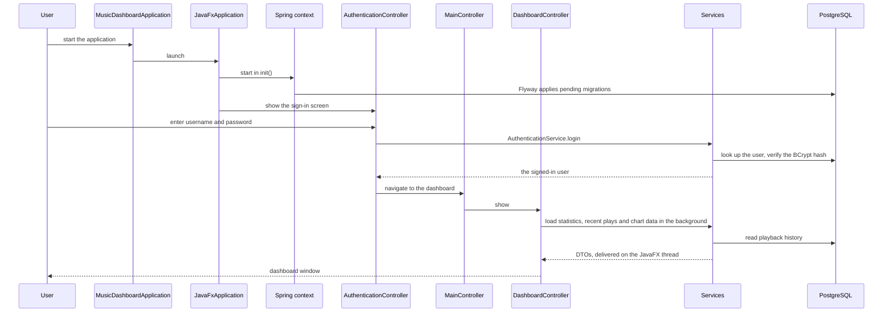

[← Back to root](../README.md)

# fx — the JavaFX desktop edition

This folder is the desktop application: a self-contained Maven project that opens MusicDashboard in its own window. The overview of the whole project, including its features, architecture, design principles, database design, privacy review and known limitations, is in the [root README](../README.md). This page covers what is specific to this folder.

## Behavior

`MusicDashboardApplication.main` hands control to `JavaFxApplication`, which starts the Spring context before any window appears and then shows the sign-in screen. After sign-in, `MainController` switches the single window between the Dashboard, Library, Playlist, Import, Reports and Settings screens. Each screen is assembled in code from JavaFX nodes and styled with the stylesheets in `src/main/resources/css`.

Audio is played inside the application by `MusicPlayerService`, using a JavaFX media player. The interface updates itself by observing that service: the playback panel, the album art and the dashboard statistics all react when the current song changes. Imports and data loading run on background threads and hand their results back to the JavaFX thread, so the window stays responsive.

Data is stored in PostgreSQL through Spring Data repositories, and Flyway creates and updates the schema at startup.

## Running it

1. Set up the database, the `DB_PASSWORD` variable and the three configuration files as described under [Getting started](../README.md#getting-started) in the root README. The files go in `src/main/resources` of this folder.
2. Open the repository in IntelliJ IDEA and load `fx/pom.xml` as a Maven project.
3. Start the "Music Dashboard" run configuration, which is stored in [.run](.run/Music%20Dashboard.run.xml). It passes the JavaFX module options to the JVM and expects an IntelliJ path variable named `PATH_TO_FX` that points at the `lib` folder of a JavaFX SDK.

To build the runnable jar instead, run `mvn package` in this folder; it is written to `target/MusicDashboard-0.0.1-SNAPSHOT.jar`.

To run without a PostgreSQL server, set `DB_PROFILE=embedded`. The application then keeps its data in an H2 file under `~/.musicdashboard`.

## Responsibilities

- Owns the desktop client: the JavaFX controllers in `controller` and the view-building code in `presentation`.
- Owns this edition's copy of the services, repositories, entities, DTOs and database migrations.
- Owns the project's changelog, diagrams and design documents.
- Does not own the browser client, which lives in [web](../web/README.md).
- Does not hold its own generated Javadoc. That is in [docs](../docs/index.html) at the repository root, because that is where GitHub Pages publishes it from.

The service, repository, entity, DTO and migration code here is mirrored in `web`. A change to any of it should be made in both editions, so that the two keep reading and writing the same database in the same way.

## S.O.L.I.D. principles used

The root README [explains each principle](../README.md#design-principles) with examples from this code. In brief:

- **Single Responsibility:** controllers only navigate and assemble scenes; `AnalyticsRowFactory` only builds rows and `AnalyticsSectionBuilder` only lays out sections.
- **Open/Closed:** `SortStrategy` gains a new sort order by adding an enum constant.
- **Liskov Substitution:** every entity defines equality on its ID in the same way.
- **Interface Segregation:** the `LibraryHandler` record hands a view only the services it needs.
- **Dependency Inversion:** `TopArtistsController` takes a `Consumer<Artist>` callback instead of depending on `MyLibraryController`.

## Code reused

- Spring Boot, Spring Data JPA, Spring Security's BCrypt encoder, Flyway, JavaFX and jaudiotagger, as listed under [Dependencies](../README.md#dependencies) in the root README.
- Within this project, the screens share `presentation/shared` (the sidebar builder, the card factory, the album art view) and the helpers in `utils`.
- The non-client layers are the same code as in [web](../web/README.md).

## Table of contents

Files:

- [pom.xml](pom.xml): the Maven build, with the JavaFX and Spring dependencies
- [CHANGELOG.md](CHANGELOG.md): what changed in each version
- [mvnw](mvnw) and [mvnw.cmd](mvnw.cmd): Maven wrapper scripts

Folders:

- [.run](.run/Music%20Dashboard.run.xml): the IntelliJ run configuration "Music Dashboard"
- [src](src): the source code
  - `src/main/java/com/sebastiandorata/musicdashboard`: the packages `controller`, `presentation`, `service`, `repository`, `entity`, `dto` and `utils`
  - `src/main/resources`: the JavaFX stylesheets in `css`, the icons, and the Flyway migrations in `db/migration`
- [Diagrams](Diagrams): design diagrams
  - Entity-relationship diagrams: [ERD001](Diagrams/ERD001.png), [ERD002](Diagrams/ERD002.png) and [ERD003](Diagrams/ERD003.png), the most recent
  - Class diagrams: [domain model](Diagrams/Domain%20Model%20Class%20Diagram.png), [domain classes](Diagrams/DomainClassDiagram.png) and [design level](Diagrams/Design-Level%20Class%20Diagram.png)
  - Interface and component designs: [dashboard](Diagrams/DashDesign001.png), [graph](Diagrams/GraphDesign.png), [card factory](Diagrams/CardFactory.png), [doubly linked list](Diagrams/DoublyLinkedList.png) and [music player observer](Diagrams/MusicPlayerObserver.png)
- [Documents](Documents): design documents
  - [MBIDandScrobbleSupportSchemaChange.md](Documents/MBIDandScrobbleSupportSchemaChange.md): the schema change that added MusicBrainz and scrobble identifiers
  - [SchemaMigrationIncidentReport.md](Documents/SchemaMigrationIncidentReport.md): the report on a schema migration failure and its fix
  - [BCNF](Documents/BCNF): the Boyce-Codd normal form write-up, as [PDF](Documents/BCNF/bcnf_normalization.pdf) and [LaTeX source](Documents/BCNF/bcnf_normalization.tex)
  - [SQL FIles](Documents/SQL%20FIles): SQL scripts for sample data, data migration and presentation queries

Back to the [root README](../README.md).

## Sequence diagram

Starting the application and reaching the dashboard:

