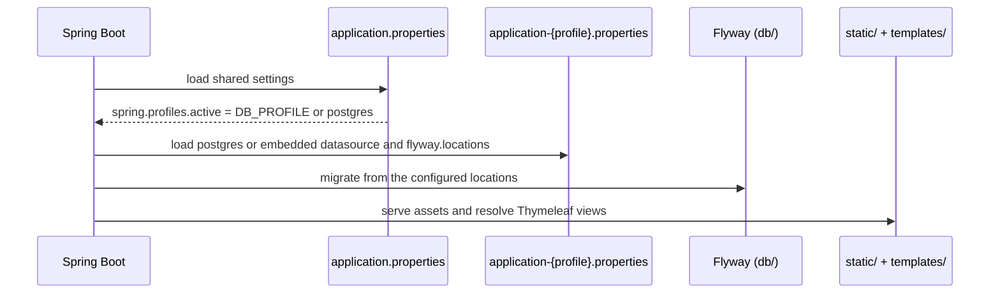

[← Back to root](../../../README.md)

# resources

## Behavior

Everything Maven copies onto the classpath unchanged. `application.properties` holds shared settings (JPA `validate`, Flyway, `server.port`, upload limits, `musicdashboard.upload-dir`) and picks the active profile from `DB_PROFILE`, defaulting to `postgres`. `application-embedded.properties` is the optional alternative: it points at the H2 file `~/.musicdashboard/data/musicdashboard` with `AUTO_SERVER=TRUE`, so no database server is needed; `application-postgres.properties` points at PostgreSQL and reads `DB_PASSWORD`. `db/` has the Flyway migrations, `static/` the JS/CSS/icons and `templates/` the Thymeleaf pages. The `application*.properties` files are git-ignored.

## Responsibilities

- Owns configuration, schema migrations, front-end assets and templates.
- Java code does not belong here, and credentials must stay out of committed files (use environment variables such as `DB_PASSWORD`).

## S.O.L.I.D. principles used

Not applicable: this folder holds no logic of its own, so none of the five principles can be shown here. Configuration and assets only.

## Code reused

None.

## Table of contents

- [application.properties](application.properties)
- [application-embedded.properties](application-embedded.properties)
- [application-postgres.properties](application-postgres.properties)
- [db/](db/README.md)
- [static/](static/README.md)
- [templates/](templates/README.md)
- [← Back to root](../../../README.md)

## Sequence diagram

