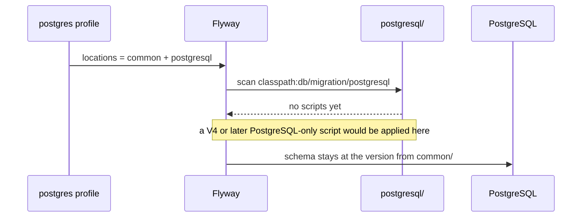

[← Back to root](../../../../../../README.md)

# postgresql

## Behavior

Reserved for migrations that only PostgreSQL should run. It is currently empty (no files): all three migrations are written in SQL that both PostgreSQL and H2 accept, so they live in `common/`. The postgres profile, which is the default, still lists this folder in `spring.flyway.locations`, so a script placed here is picked up automatically.

An earlier `V3__songs_file_path_nullable.sql` in this folder was removed. It had the same version number as the script of that name in `common/`, which made Flyway refuse to start on PostgreSQL, and its `SET NULL` syntax is not valid PostgreSQL. The `common/` script uses `DROP NOT NULL`, which both engines accept.

## Responsibilities

- Owns SQL that only PostgreSQL accepts, if any is ever needed.
- Shared SQL belongs in `common/`. Never reuse a version number that exists in `common/`, because the postgres profile loads both folders and Flyway rejects two scripts with the same version.

## S.O.L.I.D. principles used

Not applicable: this folder holds no logic of its own, and currently no files.

## Code reused

None.

## Table of contents

There are no files in this folder yet.

- [← Back to root](../../../../../../README.md)

## Sequence diagram

